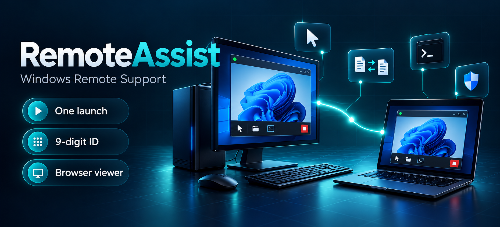
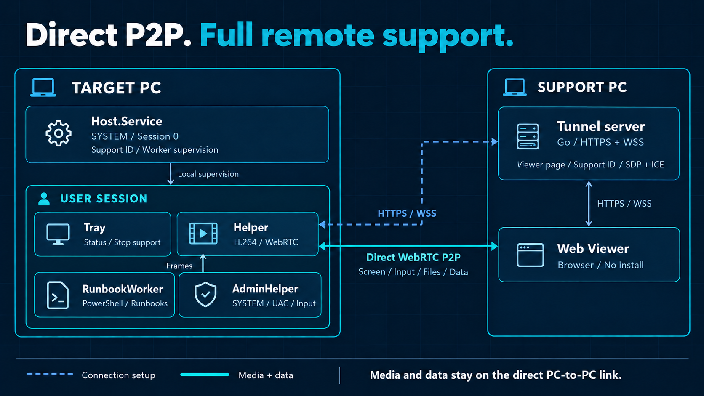

# RemoteAssist



<p align="center">
  <strong>대상자는 한 번 실행하고, 지원자는 브라우저에서 해결한다.</strong><br>
  사내 PC 운영에 필요한 화면 제어 · 관리자 작업 · 파일 전송 · 진단 · 원격 명령을 한곳에서 처리한다.
</p>

<p align="center">
  <a href="#핵심-특징">핵심 특징</a> ·
  <a href="#지원-흐름">지원 흐름</a> ·
  <a href="#연결-구조">연결 구조</a> ·
  <a href="#개발-시작">개발 시작</a> ·
  <a href="#사용-예시">사용 예시</a> ·
  <a href="docs/README.md">개발자 문서</a>
</p>

**RemoteAssist**는 사내 PC 관리 운영 부서를 위한 Windows 원격 지원 도구다. 지원을 요청한 사람이 프로그램을 **관리자 권한으로 한 번 실행**하면, 지원자가 **고정 9자리 지원 ID**로 접속해 작업한다. 지원자 PC에는 별도 Viewer를 설치할 필요가 없다.

저장소 이름은 **KnockHB**, 제품 이름과 코드 네임스페이스는 **RemoteAssist**다. 위 이미지는 제품 특징을 표현한 일러스트다.

## 핵심 특징

| 특징 | 운영에서 얻는 이점 |
|---|---|
| **한 번 실행하면 지원 준비 완료** | 대상자의 최초 관리자 실행으로 지원을 허가한다. 접속할 때마다 PIN을 전달하거나 추가 승인할 필요가 없다. |
| **브라우저가 곧 지원 도구** | 지원자는 웹 Viewer에서 접속한다. 화면을 보면서 입력·파일·채팅·진단·명령 실행을 함께 처리한다. |
| **같은 ID로 다시 연결** | 고정 9자리 지원 ID를 사용한다. 연결이 끊기면 자동으로 재접속하며, 서비스 재시작·업데이트 뒤에도 지원 허가가 유지된다. |
| **관리자 작업까지 이어지는 제어** | 연결되면 자동으로 관리자 모드를 사용한다. 관리자 창, UAC 보안 데스크톱, 잠금 화면을 조작하고 Ctrl+Alt+Del을 보낼 수 있다. |
| **반복 작업도 원격에서 처리** | 시스템 진단, 등록된 Runbook, 사용자 또는 SYSTEM 권한의 PowerShell 명령으로 점검과 조치를 수행한다. |
| **두 PC 사이 직접 P2P** | 화면·입력·파일은 지정 IP의 두 PC 사이를 직접 오간다. 터널링 서버는 Viewer 제공과 연결 설정을 맡는다. |

대상자에게는 **접속 표시와 Tray의 즉시 종료 버튼**이 보인다. 대상자가 지원을 종료하면 지원 허가도 폐기된다.

## 지원 흐름

| 단계 | 대상자 | 지원자 |
|---|---|---|
| **01 · 실행** | 프로그램을 받아 관리자 권한으로 한 번 실행한다. | 지원자 PC의 터널링 서버와 웹 Viewer를 준비한다. |
| **02 · 연결** | 표시된 고정 9자리 지원 ID를 전달한다. | 브라우저에서 지원 ID를 입력해 접속한다. |
| **03 · 해결** | 추가 조작 없이 지원을 받는다. | 화면 제어, 관리자 작업, 파일 전송, 진단과 명령 실행을 수행한다. |

지원 허가는 현재 Windows 로그온에 연결된다. **재부팅·로그오프·사용자 변경·즉시 종료·Tray 종료** 뒤에는 대상자가 다시 관리자 권한으로 실행해야 한다. 자세한 동작은 [제품 계약](docs/README.md#product-contract)과 [워크플로우](docs/README.md#workflows)를 따른다.

## 제공 기능

| 영역 | 기능 |
|---|---|
| **화면** | H.264 화면 전송, 하드웨어 인코더 우선 선택과 소프트웨어 폴백, WGC/DXGI 캡처, 적응 품질, 다중 모니터 전환 |
| **입력·관리자 제어** | 마우스·키보드·한글 입력, 관리자 창·UAC·잠금 화면 조작, Ctrl+Alt+Del |
| **파일·클립보드** | 양방향 파일 전송과 SHA-256 무결성 확인, 텍스트 클립보드 보내기·읽기 |
| **소통** | 양방향 채팅, 대상자 접속 표시, 즉시 종료 |
| **진단·자동화** | 시스템 진단, 등록된 Runbook, 사용자 또는 SYSTEM 권한의 원격 PowerShell 명령 |
| **연결 관리** | 고정 지원 ID, 자동 재접속, 다른 Viewer 접속 시 지원자 교체 |

텍스트 클립보드는 Viewer에서 명시적으로 보내거나 읽는다. 자동 동기화하지 않는다.

## 연결 구조



**연결 설정**은 지원자 PC의 Go 터널링 서버가 HTTPS/WSS로 처리한다. 대상 PC는 설치 때 받은 서버 주소로 접속하고, 서버는 Viewer 페이지·지원 ID 방·첫 SDP/ICE 교환을 제공한다.

**화면과 데이터**는 Host.Helper와 웹 Viewer 사이의 WebRTC 직접 P2P 연결로 전송한다. 미디어는 DTLS-SRTP, 데이터 채널은 SCTP over DTLS를 사용한다. STUN/TURN이나 릴레이는 사용하지 않는다.

**대상 PC 내부**에서는 SYSTEM 서비스가 지원 허가와 헬퍼 수명을 관리한다. 캡처·입력은 대상 사용자 세션의 Helper와 SYSTEM AdminHelper가 처리하고, Tray가 접속 표시와 즉시 종료를 제공한다. RunbookWorker는 등록 작업과 원격 명령을 실행한다. 자세한 책임과 실행 경계는 [아키텍처](docs/README.md#architecture)에 있다.

### 기술 스택

| 영역 | 기술 |
|---|---|
| **Host** | C# · .NET 10 LTS · WPF · Windows 10/11 x64 |
| **화면·미디어** | SIPSorcery 10.0.x · FFmpeg 8.1 LGPL · H.264 · WGC 우선 / DXGI 폴백 |
| **관리자 제어** | SYSTEM AdminHelper · Win32 `SendInput` · `SendSAS` |
| **터널링 서버** | Go · `net/http` · `coder/websocket` · TCP 25001 |
| **Viewer** | 정적 HTML/CSS/바닐라 JavaScript · 브라우저 내장 WebRTC · Node.js 빌드 단계 없음 |
| **연결 보호** | HTTPS/WSS · 사설망 자체 서명 인증서와 Host 핀 고정(`RA_MODE=lan`) |

## 개발 시작

저장소 루트의 PowerShell에서 실행한다.

| 준비물 | 용도 |
|---|---|
| Windows 10/11 x64 + .NET 10 SDK(WindowsDesktop 포함) | Host 빌드와 테스트 |
| Go 1.27 | 터널링 서버 빌드와 테스트 |
| Node.js 22 이상 | Viewer 테스트 실행 |
| Python + `cryptography` | TLS 시험 인증서 생성 |

### 1. FFmpeg 준비

고정된 LGPL DLL을 내려받아 배치한다. 바이너리는 저장소에 커밋하지 않는다.

```powershell
powershell -NoProfile -ExecutionPolicy Bypass -File scripts/prepare-ffmpeg.ps1
```

### 2. 빌드와 회귀 테스트

```powershell
dotnet restore RemoteAssist.slnx --locked-mode
dotnet build RemoteAssist.slnx --no-restore
dotnet run --project tests/RemoteAssist.Host.Core.Tests --no-build

Push-Location server/tunnel
try {
    go build ./...
    go vet ./...
    go test ./...
} finally {
    Pop-Location
}

node --test web/viewer/tests/*.test.js
```

일괄 검증과 증거 수집은 `scripts/verify-local.ps1`을 사용한다. Host 배포와 최초 실행은 [설치/업데이트](deploy/installation.md), [최초 관리자 실행](docs/README.md#startup-preparation), [터널링 서버 운영](deploy/tunnel/README.md)을 따른다.

화면 캡처를 포함하는 한 PC 루프백 검사와 두 PC 실연결 시험은 별도 계획·사전 준비·명시적 실행 승인 후 진행한다. 절차와 판정 기준은 [두 PC 실연결 시험](docs/README.md#live-e2e-test)에 있다.

## 저장소 구조

| 경로 | 내용 |
|---|---|
| `src/` | Host.Service · Host.Tray · Host.Helper · Host.AdminHelper · Host.RunbookWorker · Host.Core · Protocol · Update |
| `server/tunnel/` | Go 터널링 서버. .NET 솔루션과 별도로 빌드한다. |
| `web/viewer/` | 지원자용 웹 Viewer |
| `tests/` | Host.Core 회귀 테스트, 설치·준비 스크립트 계약 테스트, 공유 fixture |
| `tools/` | HostRun · CaptureDump · LoopbackCheck 등 개발용 진단 도구 |
| `scripts/` | 빌드·패키징·개발 설치·실연결 준비와 측정 스크립트 |
| `deploy/` | 설치·준비 스크립트, Runbook, 터널링 서버 컨테이너 |
| `third_party/ffmpeg/` | FFmpeg 공급 기준과 LGPL 고지. 바이너리는 커밋하지 않는다. |
| `docs/` | 지속적으로 유지하는 기준 문서와 문서용 이미지 |
| `docs_working/` | 임시 계획·조사·리뷰·작업 기록을 보관하는 디렉터리 |

## 문서 안내

[통합 개발자 문서](docs/README.md)에서 시작한다.

| 문서 | 찾을 수 있는 내용 |
|---|---|
| [제품 계약](docs/README.md#product-contract) | 신뢰 모델, 기능 범위, 수용 기준 |
| [아키텍처](docs/README.md#architecture) | 프로세스 구조, 지원 허가·세션 수명, 권한 경계 |
| [기술 사양](docs/README.md#technical-specification) | 설정, 상한, 의존성 |
| [프로토콜](docs/README.md#protocol) | 와이어 포맷의 단일 기준 |
| [워크플로우](docs/README.md#workflows) | 시작·연결·기능·재접속 흐름 |
| [최초 관리자 실행](docs/README.md#startup-preparation) | 지원 허가, 방화벽·SAS·GPU 준비 |
| [두 PC 실연결 시험](docs/README.md#live-e2e-test) | 시험 방법, 실측 결과, 남은 과제 |
| [설치/업데이트](deploy/installation.md) | 서명·보호 설치·롤백 |
| [터널링 서버 운영](deploy/tunnel/README.md) | TLS·감사·컨테이너 |

## 라이선스·운영

- FFmpeg는 **LGPL 빌드만 동적 링크**로 동봉한다. GPL 구성 요소인 `libx264`는 사용하지 않는다. 공급 기준과 고지는 [FFmpeg 안내](third_party/ffmpeg/README.md)에 있다.
- 사내 배포 통제, 대상자 접속 표시·즉시 종료, 감사 기록을 운영 전제로 한다. 배포 시 조직 보안 정책과 관련 법규를 검토한다.

## 사용 예시

업무 PC에 문제가 생겨 사내 담당자에게 원격 지원을 받는 상황이다. 대상자가 프로그램을 실행해 지원 ID를 전달하면, 지원자가 브라우저로 접속해 문제를 해결한다. 지원자 PC의 터널링 서버가 준비된 환경을 기준으로 한다.


그림의 `418-207-935`는 예시 ID다. 실제 접속에는 대상 PC에 표시된 지원 ID를 사용한다.
