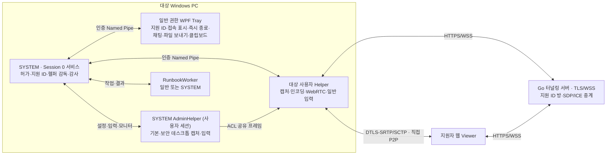

# RemoteAssist 개발자 문서

사내 PC 관리 운영 부서가 쓰는 Windows 원격 지원 도구다. 저장소 이름은 KnockHB이고 제품/네임스페이스는 RemoteAssist다.

지원자 PC와 대상 PC는 서로 신뢰하는 관계다. 지원을 요청한 사람이 프로그램을 받아 관리자 권한으로 한 번 실행하면, 그 뒤 대상자는 아무것도 하지 않는다. 지원자가 고정 9자리 지원 ID로 접속해 화면·입력·관리자(UAC)·파일·클립보드·진단·Runbook·원격 명령·모니터 전환을 모두 쓴다. 승인 창·PIN·건별 승인은 없다. 연결이 끊기면 같은 지원 ID로 자동 재접속한다.

대상 PC는 SYSTEM 서비스, 일반 권한 WPF Tray/Helper, SYSTEM AdminHelper로 구성된다. 지원자 PC에는 Go 터널링 서버와 웹 Viewer가 있다. 프로세스 간 연결은 [아키텍처](#architecture)를 따른다. 미디어·데이터는 두 PC 사이 직접 P2P(DTLS-SRTP/SCTP)로만 흐른다. STUN/TURN 서버는 없다.

<a id="contents"></a>

## 목차

| 절 | 기준 |
|---|---|
| [제품 계약](#product-contract) | 지원 대상·신뢰 모델·기능 범위·수용값 |
| [아키텍처](#architecture) | 프로세스·Session/SID·감독·수명·코드 책임 |
| [기술 사양](#technical-specification) | 기술 스택·고정 의존성·설정·상한 |
| [프로토콜](#protocol) | 유일한 와이어 필드/역할/세대 기준 |
| [워크플로우](#workflows) | 시작·연결·미디어·입력·관리자·보조 기능·복구 |
| [최초 관리자 실행](#startup-preparation) | 지원 허가와 OS 준비 |
| [두 PC 실연결 시험](#live-e2e-test) | E2E 준비·실행·판정·성능 측정·정리 |
| [현재 상태와 남은 과제](#e2e-status) | 실연결 결과·보류·미시험 항목 |
| [설치/업데이트](../deploy/installation.md) | 서명·보호 설치·transaction/rollback |
| [터널링 서버 운영](../deploy/tunnel/README.md) | TLS·감사·metrics·컨테이너 |

제품 계약·설계·기술 사양·프로토콜·워크플로우·시작 준비·실연결 시험의 기준은 이 문서 하나로 관리한다. 설치·업데이트와 터널링 서버 운영 문서는 `deploy/`에서 유지한다. `docs_working/`은 개발 중 사용하는 임시 계획·조사·리뷰·작업 기록을 보관하는 디렉터리다. 스키마 변경은 [프로토콜 절](#protocol) → C#/Go/JS 순서다. 구현됨(빌드·단위 테스트 통과)과 실제 두 PC 동작 확인은 구분한다.

<a id="product-contract"></a>

## 제품 계약과 수용 기준

<details>
<summary>이 절의 목차</summary>

- [사용 맥락과 신뢰 모델](#product-contract-사용-맥락과-신뢰-모델)
- [연결 규격](#product-contract-연결-규격)
- [기능 범위](#product-contract-기능-범위)
- [상태 전이](#product-contract-상태-전이)
- [시험 기준](#product-contract-시험-기준)

</details>

현재 제품의 신뢰 모델과 수용 기준이다. 대상자의 최초 관리자 실행으로 지원을 허가하며 별도 건별 승인이나 PIN은 사용하지 않는다.

<a id="product-contract-사용-맥락과-신뢰-모델"></a>

### 사용 맥락과 신뢰 모델

- 사내 PC 관리 운영 부서가 쓴다. 지원을 요청한 사람이 프로그램을 받아 직접 실행한다. 지원자와 대상 PC는 서로 신뢰한다.
- 대상자가 프로그램을 **관리자 권한으로 한 번** 실행하면 지원 허가가 생긴다. 그 뒤 대상자는 아무것도 하지 않는다.
- 지원자는 대상 PC의 **고정 9자리 지원 ID**로 접속한다. PIN·일회성 코드·본인 확인·승인 창은 없다. 접속하면 항상 전 권한을 받는다.
- 지원 허가는 서비스 재시작·업데이트 뒤에도 유지되고, **재부팅·로그오프·Windows 사용자 변경·대상자의 즉시 종료·Tray 종료** 때 사라진다. 그 뒤에는 대상자가 다시 관리자 권한으로 실행한다.
- 대상자가 볼 수 있는 접속 표시(화면 테두리·Tray 배지)와 Tray의 **즉시 종료** 버튼은 남긴다. 즉시 종료 단축키(`Ctrl+Alt+Shift+F10`)와 Tray 창 닫기로도 지원을 끝낼 수 있다.
- 터널링 서버는 TLS(HTTPS/WSS)다. 사설망에서는 자체 서명 인증서를 Host가 핀 고정한다. 평문 LAN 모드는 제공하지 않는다.

<a id="product-contract-연결-규격"></a>

### 연결 규격

- 두 PC는 지정 IP로 항상 직접 연결된다(STUN/TURN 없음, host 후보만). 연결 가능성 분기나 릴레이 폴백은 없다. 실제 연결 오류는 결함으로 조사한다.
- 대상 PC 한 대에는 지원자 한 명이 연결된다. 다른 Viewer가 같은 ID로 접속하면 새 Viewer가 이어받고, 밀려난 Viewer는 재접속하지 않는다.
- 지원자가 나가면 대상 PC는 1초 안에 같은 지원 ID로 다시 대기한다. Viewer는 끊기면 자동으로 다시 접속한다.

<a id="product-contract-기능-범위"></a>

### 기능 범위

| 기능 | 내용 |
|---|---|
| 화면 | WGC 우선·DXGI 폴백, H.264(HW 우선·libopenh264 SW 폴백), 다중 모니터 전환, 적응 품질 |
| 입력 | 마우스·키보드·IME 확정 문자. 연결되면 자동으로 관리자 모드로 들어가 상승 창·UAC·잠금 화면에도 입력한다 |
| 관리자 | SYSTEM AdminHelper가 현재 입력 데스크톱(기본·보안)을 캡처·조작한다. Ctrl+Alt+Del(SAS) 전송 |
| 파일 | 지원자 → 대상: 대상 사용자의 `다운로드\RemoteAssist`에 자동 저장. 대상 → 지원자: 대상자가 Tray에서 보내거나 지원자가 원격 조작으로 보낸다 |
| 클립보드·채팅 | 명시 get/set, 텍스트 채팅 |
| 진단 | CPU·메모리·디스크·네트워크·오류 이벤트·시작 항목·서비스 |
| Runbook | 등록된 고정 작업 + 원격 PowerShell 명령(사용자 또는 SYSTEM 권한) |

<a id="product-contract-상태-전이"></a>

### 상태 전이

| 상태 | 전이 | 비고 |
|---|---|---|
| 허가 없음 | 허가(관리자 실행) | Tray가 "관리자 권한으로 실행" 안내 |
| 대기 | 연결, 허가 폐기 | 지원 ID 방이 열려 있다 |
| 연결 | 대기(지원자 이탈), 허가 폐기 | 전 권한. 일시 단절은 같은 터널링 서버 위에서 전송 재구성 |

<a id="product-contract-시험-기준"></a>

### 시험 기준

아래 값은 시험 전에 고정한 수용 기준이며 실측값이 아니다. 결과에 맞춰 낮추지 않는다.

| 항목 | 기준 |
|---|---|
| 재접속 | 지원자 이탈 후 Host 재대기 1초(연속 실패 5초), Viewer 재시도 2초부터 최대 10초 간격 |
| 협상 | offer 수신 후 30초 |
| 터널링 서버 heartbeat | 5초 간격, 15초 무응답 종료 |
| 전송 재구성 | 2초 단절 확인, 연속 최대 3회·5초 간격·각 30초 |
| 1080p 인코딩 | 실제 출력 30fps 이상 |
| 1080p LAN 송신·표시 | 60초 측정 평균 30fps 이상 |
| LAN 입력-표시 | p95 150ms 이하 |
| 메시지 | 터널링 서버 128KiB, 데이터 JSON 32KiB, ICE 대기 256개 |

정식 코드 서명 인증서·TLS 터널링 서버·두 물리 PC는 외부 준비물이다. 개발 인증서나 단일 PC 시험을 정식 배포 수용으로 세지 않는다.

[목차로 돌아가기](#contents)

---

<a id="architecture"></a>

## 아키텍처

<details>
<summary>이 절의 목차</summary>

- [실행 경계](#architecture-실행-경계)
- [지원 허가와 지원 ID](#architecture-지원-허가와-지원-id)
- [세션 수명](#architecture-세션-수명)
- [소유권과 종료](#architecture-소유권과-종료)
- [미디어와 입력](#architecture-미디어와-입력)
- [보조 기능](#architecture-보조-기능)
- [연결 복구](#architecture-연결-복구)
- [설치·업데이트](#architecture-설치업데이트)
- [코드 읽기](#architecture-코드-읽기)

</details>

신뢰 모델과 기능 범위는 [제품 계약](#product-contract), 와이어 포맷은 [프로토콜](#protocol)이 기준이다.

<a id="architecture-실행-경계"></a>

### 실행 경계



터널링 서버는 지원자 PC(A)가 여는 접속 지점이다. 대상 PC는 설치 때 받은 A의 주소(`TunnelUri`)로 직접 접속하고, 브라우저는 포트를 열 수 없으므로 이 서버가 Viewer 페이지 제공과 첫 SDP/ICE 교환을 맡는다. 화면·입력은 이 서버를 거치지 않고 두 PC가 직접 주고받는다. 예전 이름은 "시그널링"이다.

서비스는 Session 0에서 캡처하지 않는다. WTS로 확인한 단일 콘솔 Session/SID에 Tray와 Helper를 만든다. 사용자가 바뀌면 지원 허가를 없애고 모든 자식을 끝낸다.

<a id="architecture-지원-허가와-지원-id"></a>

### 지원 허가와 지원 ID

- 대상자가 `RemoteAssist.Update.exe`(정식: `support`, 개발: `support-dev`)를 관리자 권한으로 실행하면 `ProgramData/RemoteAssist/initial-support.json`에 허가를 쓴다. 허가는 콘솔 사용자 SID·Windows 세션·로그온 시각에 묶인다. 파일 ACL은 SYSTEM/Administrators만 허용한다.
- 서비스는 시작할 때마다 허가를 읽는다(`InitialSupportLaunch.Load`). 같은 로그온(사용자·세션·로그온 시각)이면 유지되므로 서비스 재시작·업데이트 뒤에도 지원이 이어진다. 재부팅·로그오프·사용자 변경이면 지운다.
- 대상자의 즉시 종료·Tray 종료·사용자 변경은 허가를 지운다(`StopSupport`).
- 지원 ID는 `ProgramData/RemoteAssist/device-id.txt`의 고정 9자리다. Helper는 매 세션 `POST /session {"code":<지원 ID>}`로 같은 방 번호를 연다.

<a id="architecture-세션-수명"></a>

### 세션 수명

1. 허가가 있고 Helper가 없으면 서비스가 Helper를 띄운다(`StartHelper`). Helper는 터널링 서버 방을 열고 지원자를 무기한 기다린다.
2. 지원자가 들어오면 Helper가 바로 전 권한(`PermissionGate.Grant`)으로 PeerConnection과 모든 기능 채널을 만든다. 승인 단계는 없다.
3. Viewer는 연결 직후 관리자 모드를 요청한다. 서비스가 AdminHelper를 띄우고, 이후 화면과 입력은 AdminHelper를 거친다(일반·상승 창·UAC·잠금 화면을 한 경로로 처리).
4. 지원자가 나가면 세션이 끝나고 서비스는 1초 뒤(시작 실패가 이어지면 5초 뒤) 새 Helper를 띄운다. 터널링 서버가 내려가 있어도 재시도한다.

<a id="architecture-일반관리자-이중-구조의-결정"></a>

#### 일반·관리자 이중 구조의 결정

일반 Helper(사용자 토큰)는 UIPI 때문에 상승 창·보안 데스크톱에 입력할 수 없다. 대상자가 이미 관리자 실행으로 허가했으므로, 연결되면 항상 관리자 모드로 들어가 SYSTEM AdminHelper가 현재 입력 데스크톱을 따라가며 캡처·입력한다. WebRTC·인코딩은 일반 Helper에 남긴다(네트워크·코덱을 SYSTEM 프로세스에 두지 않기 위해). 관리자 헬퍼 시작이 실패하면 일반 모드로 계속하고 Viewer는 다시 시도할 수 있다. 확인한 GPU 조합과 미시험 항목은 [실연결 현재 상태](#e2e-status)를 따른다.

<a id="architecture-소유권과-종료"></a>

### 소유권과 종료

- `ScreenShareSession`이 직렬 이벤트 큐·터널링 서버 수신·heartbeat·연결 generation·캡처 스레드를 소유한다. 캡처·스케일러·인코더는 캡처 스레드 하나에서 만들고 쓰고 버린다. 오래된 PeerConnection·채널 callback은 generation 검사로 버린다.
- 서비스의 Job이 Helper·AdminHelper·RunbookWorker를 소유한다. 헬퍼가 멈추면 Job 종료로 정리한다. 입력은 Helper 안의 `InputSession`이 눌린 키·버튼을 추적해 정지·일시 중단 때 떼고, AdminHelper는 데스크톱을 떠날 때 자기가 누른 키를 뗀다.
- `session.gate` 파일 잠금은 지원자가 연결된 동안만 잡는다. 업데이트 설치는 연결이 없을 때 진행한다.
- 감사 기록(`AuditJournal`)은 지원을 막지 않는다. 기록 실패는 `service-status.ndjson`에 남긴다.

<a id="architecture-미디어와-입력"></a>

### 미디어와 입력

- 모니터 identity/geometry를 세션에 묶는다. WGC 우선, 초기화 실패 때 같은 모니터의 DXGI를 쓴다. 해상도·배치가 바뀌면 같은 모니터(없으면 주 모니터)로 자동으로 다시 맞춘다.
- 관리자 모드 중에도 모니터를 바꿀 수 있다. Helper가 입력 좌표 기준을 옮기고 AdminHelper에 `admin-monitor`로 새 모니터를 알린다.
- 관리자 모드가 아닐 때 보안 데스크톱(UAC·잠금)이 뜨면 세션을 끊지 않고 마지막 화면을 유지한다.
- FFmpeg 8.1 LGPL DLL만 hash 검사 후 고정 경로에서 로드한다. 후보는 nvenc → qsv → amf → mf → openh264 순서이며 libx264는 금지다.
- 입력은 input/pointer 채널을 분리하고 순번·inputEpoch·barrier로 오래된 입력을 거부한다. 좌표는 0~1 정규화다.

<a id="architecture-보조-기능"></a>

### 보조 기능

- 파일: 한 번에 한 건, 16KiB 청크, credit 배압, SHA-256, NTFS handle 기반 원자 확정. 수신 파일은 대상 사용자 다운로드 폴더 아래 `RemoteAssist`에 저장하며 기존 파일을 덮어쓰지 않는다.
- 클립보드·채팅·진단은 각자 상한을 둔 채널이다.
- Runbook: 등록 작업(고정 source/hash)과 원격 PowerShell 명령. 서비스가 일반 또는 SYSTEM worker Job으로 실행하며 20초·출력 상한이 있다.

<a id="architecture-연결-복구"></a>

### 연결 복구

일시 ICE 단절이 2초 이어지면 Host가 같은 터널링 서버 위에서 다음 generation offer로 전송을 다시 만든다(최대 3회). 터널링 서버가 끊기거나 지원자가 나가면 세션을 끝내고 Host가 같은 지원 ID로 다시 대기한다.

<a id="architecture-설치업데이트"></a>

### 설치·업데이트

정식 설치는 Program Files/RemoteAssist/versions의 보호 ACL 경로다. Authenticode 서명 Host, RSA-PSS 서명 manifest/ZIP 검증, pending transaction → 서비스 image 전환 → ready → commit 순서이며 실패하면 직전 버전으로 rollback한다. 개발 설치(Program Files/RemoteAssist-Dev)와 빌드 출력 실행은 개발 모드로 보고 보호 경로 ACL·릴리스 manifest 검사를 생략한다. 정식 설치 검사는 배포 단계에서 다시 검토한다.

<a id="architecture-코드-읽기"></a>

### 코드 읽기

아래 경로에서 `Host.*`는 `src/RemoteAssist.Host.*`, `Service/`는 `src/RemoteAssist.Host.Service/`, `Deployment/`·`Media/` 등은 `src/RemoteAssist.Host.Core/` 아래다.

| 코드 | 책임 |
|---|---|
| Host.Service/HostSessionSupervisor | 콘솔 Session/SID·지원 허가 읽기/폐기·Tray/Helper/AdminHelper/Runbook Job 감독·자동 재대기·감사(실패해도 계속) |
| Deployment/InitialSupportLaunch, DeviceId | 관리자 실행 허가(로그온 시각·사용자·세션 결합)와 고정 지원 ID |
| Deployment/InstallationState, StartupPreparation | 정식/개발 모드 구분, 보호 경로·manifest 검사(정식만), 방화벽 준비 검증 |
| Windows/SessionProcess, ProtectedInstallation | WTS 실행·고정 역할/이미지·토큰·Job |
| Ipc/LocalIpcEndpoint, IpcPeerSession | 로컬 ACL·PID/SID/Session/nonce 인증·크기/순번·heartbeat |
| Security/PermissionGate, AdminAuthorization | 연결된 지원자에게 전 권한 부여·세션 종료 뒤 차단, 관리자 세대 |
| ScreenShareSession | 직렬 이벤트·generation·PeerConnection/채널·캡처 스레드·모니터 전환·데스크톱 전환·전송 재구성·멱등 종료 |
| Capture/WgcScreenCapture, DxgiScreenCapture | 같은 모니터 identity·BGRA/stride·geometry·rotation/cursor |
| Media/BgraFrameScaler, FFmpegH264Encoder | 재사용 버퍼·짝수 출력·후보별 실제 init/SPS·키프레임 |
| Media/H264Contract, FrameRtpClock, H264RtpPayloads | SDP profile/level·단조 90kHz·NAL/FU-A |
| Input/InputSequenceGuard, InputDataSession, InputSession | 채널별 순번/barrier/epoch·move 합치기·눌린 키 추적과 해제·일시 중단/재개 |
| Security/AdminDesktopRuntime, AdminFrameSource, Service/AdminScope | 현재 입력 데스크톱 추적 캡처·입력, 모니터 재바인딩, 공유 프레임 |
| Files/FileTransferSession, DownloadFolder | 한 건·credit·SHA256·NTFS handle 확정·다운로드 폴더 자동 저장 |
| Media/FeatureDataChannel, Diagnostics | chat/clipboard/진단 한도 |
| Runbooks, Media/RunbookDataSession, Service/RunbookScope | 등록 작업·원격 명령·worker Job·20초/출력 상한 |
| Security/AuditJournal, Service/AuditReporter | 폐쇄 metadata 저널·선택적 서버 보고 |
| RemoteAssist.Update, deploy/install.ps1 | 관리자 실행 진입점(support/support-dev)·서명 설치/업데이트·rollback |
| Go room/tunnel | 지원 ID 방·ACK 원자성·역할·재협상 세대·Viewer 교체·상한·TLS |
| Viewer connection/input/features/files/runbooks/app | 연결 객체·자동 관리자 모드·자동 재접속·좌표·파일·원격 명령 UI |

캡처 스레드는 모니터·품질 변경을 프레임 경계에서 적용한다. 일반 모드 모니터 전환은 캡처 스레드가 새 캡처를 만들고 첫 프레임을 보낸 뒤 완료되고, 관리자 모드 전환은 AdminHelper가 다음 데스크톱 루프에서 새 모니터를 연다. 두 경우 모두 입력을 멈췄다가 새 epoch로 재개한다.

EndSession은 최종 송신과 직렬화해 권한·큐를 먼저 폐기하고 Completion 원인을 한 번 확정한다. Dispose는 native thread/task 종료를 기한 안에서 기다리며 실행 중인 native 객체를 먼저 해제하지 않는다. 서비스는 헬퍼 crash/hang·IPC 상실에서 Job을 끝내고 허가가 있으면 다시 대기한다.

감사 로그는 고정 kind/ID/결과 metadata만 쓴다. 예외 본문·token·클립보드·파일 경로·스크립트 출력은 감사에 없다.

[목차로 돌아가기](#contents)

---

<a id="technical-specification"></a>

## 기술 사양

<details>
<summary>이 절의 목차</summary>

- [기술 스택과 버전 기준](#technical-specification-기술-스택과-버전-기준)
- [Host 설정 (`host.settings.json`)](#technical-specification-host-설정-hostsettingsjson)
- [터널링 서버 환경](#technical-specification-터널링-서버-환경)
- [미디어·데이터](#technical-specification-미디어데이터)
- [개발 진단 도구](#technical-specification-개발-진단-도구)
- [개발 스크립트와 도구 유지 기준](#development-scripts-and-tools)

</details>

[제품 계약](#product-contract)·[프로토콜](#protocol)이 지원/수용값과 와이어 기준이다. 진행 상태는 [실연결 현재 상태](#e2e-status)에서 관리한다.

<a id="technical-specification-기술-스택과-버전-기준"></a>

### 기술 스택과 버전 기준

| 영역 | 선택·기준 파일 |
|---|---|
| Host / UI | C# .NET 10 / WPF. Windows 캡처·입력·서비스·Named Pipe를 담당한다 |
| 터널링 서버 | Go / `net/http` / `github.com/coder/websocket`. Viewer 정적 파일과 SDP/ICE 교환을 담당한다 |
| Viewer | 정적 HTML/CSS/바닐라 JS ES module, 브라우저 WebRTC. Node는 회귀 테스트용이며 제품 빌드 단계는 없다 |
| .NET SDK | [global.json](../global.json): `10.0.100`, `rollForward: latestMinor`. 10.0.400 한 버전으로 고정한 것이 아니다 |
| TFM | [Directory.Build.props](../Directory.Build.props)의 `WindowsTfm`: `net10.0-windows10.0.19041.0`. Protocol은 `net10.0` |
| Windows 대상 | Windows 10 2004(build 19041) 이상 / Windows 11, x64. API 타깃 하한이며 모든 OS·GPU 조합의 실증을 뜻하지 않는다 |
| Go | [go.mod](../server/tunnel/go.mod): `go 1.27`, `coder/websocket v1.8.15`; 체크섬은 `go.sum` |

NuGet은 [Directory.Packages.props](../Directory.Packages.props)에서 중앙 관리하고 프로젝트별 `packages.lock.json`과 `--locked-mode`로 복원한다. 의존성을 바꾸면 해당 manifest·lock 파일과 이 절을 함께 갱신한다.

| 패키지 | 고정 버전 | 용도 |
|---|---|---|
| `SIPSorcery` | 10.0.16 | WebRTC |
| `SIPSorceryMedia.FFmpeg` | 10.0.16 | H.264 인코딩 |
| `Vortice.Direct3D11`, `Vortice.DXGI` | 3.8.3 | D3D11·DXGI 캡처 |
| `Microsoft.Extensions.Hosting`, `.Hosting.WindowsServices`, `.Logging.Abstractions`, `.Logging.Console` | 10.0.11 | 서비스·로깅 |
| `System.Diagnostics.EventLog`, `System.ServiceProcess.ServiceController` | 10.0.11 | 이벤트·서비스 진단 |

FFmpeg는 8.1 ABI의 LGPL shared 빌드만 사용한다. 공급 URL·archive hash는 [supply.json](../third_party/ffmpeg/supply.json), DLL hash는 [libraries.json](../third_party/ffmpeg/libraries.json)이 기준이다. 현재 공급본은 `n8.1.3-14-g330caae0c1-20261007`이다. 과거 `n8.1.2` 개발본과 혼용하지 않는다. 동적 DLL을 별도로 유지하며 공급·고지 절차는 [FFmpeg 문서](../third_party/ffmpeg/README.md)를 따른다.

`SIPSorceryMedia.Encoders`, `SharpDX`, GPL/nonfree/libx264 포함 FFmpeg는 사용하지 않는다. 개발 포트 범위는 TCP 25001~25199 / UDP 27001~27199이며 터널링 서버는 TCP 25001, Host WebRTC는 UDP 27002~27099를 사용한다.

<a id="technical-specification-host-설정-hostsettingsjson"></a>

### Host 설정 (`host.settings.json`)

| 항목 | 기본/검사 |
|---|---|
| TunnelUri | 기본 `http://localhost:25001`. 기본값 그대로는 검증 실패: HTTPS로 설정하거나 개발 loopback에서만 `AllowLoopbackHttp=true`를 지정한다 |
| AllowLoopbackHttp | false. true면 loopback http만 허용 |
| TunnelCertificateBase64 | 선택. 지정하면 그 DER 인증서와 정확히 일치하는 서버만 신뢰(자체 서명 핀 고정). 머신 인증서 저장소는 바꾸지 않는다 |
| TargetFps / BitrateKbps | 30 / 4000; 1..60 / 100..50000 |
| MonitorIndex | 0; 시작 시 현재 목록 범위 |
| PreferredEncoder | null은 허용 후보 순서, 명시는 단일 후보 엄격 실패 |
| MaxOutputLongEdge / ShortEdge | 1920 / 1080, 최대 3840/2160, 짝수 축소·확대 없음 |
| StunServers | 무시한다. 이미 배포된 설정에 남아 있어도 읽기만 한다 |

알 수 없는 필드·중복 필드는 거부한다. 서비스는 설정의 `DeviceCode` 값과 관계없이 `ProgramData/RemoteAssist/device-id.txt`에서 읽은 지원 ID로 덮어쓴다.

<a id="technical-specification-터널링-서버-환경"></a>

### 터널링 서버 환경

| 환경 변수 | 정책 |
|---|---|
| RA_MODE | `development`(loopback 평문만), `lan`(사설 IP 또는 0.0.0.0, TLS 필수, 자체 서명 가능), `production`(TLS 필수) |
| RA_LISTEN | 기본 127.0.0.1:25001; TCP 25001..25199 |
| RA_TLS_CERT / RA_TLS_KEY | lan·production 필수 |
| RA_SESSION_TTL | Host 참가 전 방의 대기 기간(고정 ID·난수 코드 공통). 기본 10m, 30s..30m. Host 참가 후에는 장기 대기한다 |
| RA_VIEWER_DIR | 선택. 허용 정적 파일만 제공 |
| RA_ALLOWED_ORIGINS | 선택. 정확한 host:port 목록, wildcard 금지. 비우면 같은 호스트만 |
| RA_OPERATOR_SECRET_FILE | 선택. `/metrics`·`/audit`의 bearer credential 파일. 지정하면 시작 때 검사한다. 미지정이면 인증 요청은 401이다 |
| RA_AUDIT_DIR | 선택. 감사 저장 디렉터리. 지정하면 시작 때 검사한다. 인증 후에도 저장소가 없으면 `/audit`는 503이다 |

정적 파일 허용 목록은 `server/tunnel/main.go`의 `viewerAssets`가 기준이다(`index.html`, `app.css`, `app.js`, `connection.js`, `input.js`, `input-geometry.js`, `features.js`, `files.js`, `sha256.js`, `runbooks.js`, `favicon.svg`). CSP·frame 차단·nosniff·referrer·HSTS를 적용한다. /healthz는 생존, /readyz는 시작 오류·감사 장애·종료 상태다.

룸 1000, 연결+upgrade 예약 2000, join 10초, heartbeat 5초/read lease 15초, 쓰기 5초, peer 이탈 통지 3초, HTTP shutdown 5초. 터널링 서버 128KiB/SDP 96KiB/ICE 8KiB, JSON depth 32. 감사 event 4096bytes, journal 4MiB×4/7일.

<a id="technical-specification-미디어데이터"></a>

### 미디어·데이터

Host WebRTC는 UDP 27002..27099의 host 후보만 쓴다. STUN/TURN은 없다. 방화벽 규칙은 Helper 실행 파일과 이 포트 범위, 터널링 서버 TCP(443, 설정 포트)에 한정한다.

캡처는 모니터 handle/deviceName/geometry·BGRA/stride를 검사한다. WGC 우선, 초기화 실패 때 같은 모니터의 DXGI를 한 번 쓴다. 보안 데스크톱은 AdminHelper의 DXGI 경로로 캡처한다. 화면 구성이 바뀌면 같은 모니터(없으면 주 모니터)로 자동으로 다시 맞춘다.

FFmpeg 8.1 ABI의 7개 shared DLL은 고정 SHA256 검사 후 명시 경로에서 로드한다. GPL/nonfree/libx264와 PATH fallback을 금지한다. H.264는 constrained baseline/mode1이며 실제 SPS의 profile/level을 검사한다. 후보 nvenc → qsv → amf → mf → openh264는 실제 Configure·시험 출력 뒤에만 선택한다. h264_amf에는 `constrained_baseline` profile 값을 쓴다(`baseline` 값이 없다). PLI/FIR와 시작·재개·2초 주기 IDR을 보낸다. RTP는 actual monotonic 90kHz sample time, 1200byte NAL/FU-A다.

파일은 최대 256MiB/청크 16KiB/credit 16/한 건·SHA256·NTFS handle 확정, 수락 30초/무진행 10초/전체 10분. chat 4096자, clipboard 8192자/UTF-8 16KiB와 hash, 2초 응답. 진단 provider 2초 상한. 수집 오류·기한 초과는 해당 진단 루프를 멈추며 화면·입력·파일 세션은 유지한다. Runbook은 등록 두 작업 + 원격 명령(8192자), 동시 1개, worker 20초, stdout 8192자·stderr 4096자, Job 자식 2개·메모리 제한.

<a id="technical-specification-개발-진단-도구"></a>

### 개발 진단 도구

HostRun은 화면만 보내는 개발 진단이다(입력·관리자·파일·Runbook은 서비스 설치본에서만 동작). `--encoder-check`는 화면·네트워크 없이 합성 1080p 60프레임으로 후보별 출력·디코딩·처리량(30fps 이상)·IDR 복구를 검사한다. CaptureDump·SessionProcess 진단·BoundaryProbe·InputTarget은 실제 화면/입력을 쓰므로 계획을 세운 뒤 실행한다.

<a id="development-scripts-and-tools"></a>

### 개발 스크립트와 도구 유지 기준

`scripts/`는 재현 가능한 빌드·검증·배포 절차를 위해 유지한다. `tools/`는 제품 내부 경로의 진단과 장애 분석을 위해 핵심 도구를 유지한다. 두 디렉터리는 개발 저장소에서 관리하며, 사용자 배포본에 디렉터리 전체를 포함할 필요는 없다. 패키징은 필요한 Host·updater·FFmpeg·Runbook·설치 스크립트 등을 골라 담는다.

| 디렉터리 | 역할 | 유지 기준 |
|---|---|---|
| `scripts/` | 의존성 준비, 빌드·검증, 패키징·설치, 운영 설정, 실연결 준비·측정 자동화 | 빌드·배포·시험에서 사용하는 스크립트는 유지하고, 특정 환경에 종속된 일회성 작업과 중복 검사는 개별 검토한다 |
| `tools/` | 캡처·인코더·WebRTC·Windows 세션·입력의 개발용 진단 실행 프로그램 | 핵심 진단·통합 검사 도구를 유지하고, 수동 진단 도구는 사용 빈도와 대체 가능성을 검토한다 |

#### scripts/의 주요 용도와 정리 후보

- `prepare-ffmpeg.ps1`: 공급본을 내려받아 hash·ABI·옵션을 확인하고 FFmpeg DLL을 배치한다.
- `verify-local.ps1`: 빌드와 회귀 테스트를 일괄 실행하고 결과 증거를 수집한다. `-Native`는 HostRun 인코더 검사와 MediaProbe도 실행한다.
- `package-host.ps1`, `package-host-dev.ps1`, `install-host-dev.ps1`: 정식 패키징과 개발 후보 생성·설치에 사용한다.
- `prepare-ffmpeg-sources.ps1`, `prepare-managed-notices.ps1`: 대응소스와 의존성 라이선스 고지를 준비한다.
- `e2e-*`, `prepare-e2e-tls.py`, `browser-*-measure.js`, `loopback-check.ps1`: 실연결 준비·성능 측정과 한 PC 통합 검사를 재현하는 데 사용한다. 실행에는 해당 시험의 계획·승인 기준을 적용한다.
- `test-pc-inventory.py`: 특정 PC의 인증 환경과 `.artifacts/python-ssh`에 의존하는 조사 스크립트다. 범용화하거나, 현재 시험 절차에서 대체 가능한지 확인해 정리할 후보로 분류한다.

#### tools/의 주요 용도와 유지 판단

아래 이름은 `tools/RemoteAssist.*` 프로젝트를 뜻한다.

| 도구 | 용도 | 유지 판단 |
|---|---|---|
| HostRun | 하드웨어 인코더 검사와 화면 송신 파이프라인 진단 | 핵심 진단 도구로 유지한다 |
| MediaProbe | 합성 프레임을 사용한 실제 코덱·WebRTC 미디어 경로와 RTCP 피드백 검사 | 핵심 진단 도구로 유지한다 |
| LoopbackCheck | 실제 Host 세션·터널링 서버와 가짜 Viewer를 사용하는 한 PC 통합 검사 | 통합 검사 도구로 유지한다 |
| CaptureDump | WGC/DXGI 캡처 결과 덤프와 GPU·모니터 출력 문제 분석 | 핵심 진단 도구로 유지한다 |
| SessionProbe | Windows 세션·데스크톱·GPU 출력의 읽기 전용 사전 조사 | 사용 빈도와 대체 가능성을 검토한다 |
| BoundaryProbe | 사용자/SYSTEM 권한·데스크톱 경계와 캡처·입력 진단 | 사용 빈도와 대체 가능성을 검토한다 |
| InputTarget | 원격 입력 결과를 기록하는 시험 대상 창 | 사용 빈도와 DesktopTestDriver의 대체 가능성을 검토한다 |

수동 진단 도구의 정리는 동일한 검증을 다른 도구가 대신하는지 확인한 뒤 결정한다. DesktopTestDriver는 별도 저장소이며, 해당 도구를 사용한다는 이유만으로 RemoteAssist의 캡처·코덱·WebRTC 진단을 모두 대체한 것으로 보지 않는다.

`tools/`의 프로젝트는 `RemoteAssist.slnx`에 등록되어 있고, 검증·시험 스크립트에서도 참조한다. 도구나 스크립트를 제거할 때는 솔루션·호출 스크립트·문서의 참조를 함께 갱신한다. 디렉터리를 통째로 삭제하면 현재 빌드·검증 절차의 참조가 깨진다.

[목차로 돌아가기](#contents)

---

<a id="protocol"></a>

## 와이어 포맷 (단일 기준)

<details>
<summary>이 절의 목차</summary>

- [터널링 서버](#protocol-터널링-서버)
- [데이터 채널 공통](#protocol-데이터-채널-공통)
- [control](#protocol-control)
- [input / pointer](#protocol-input--pointer)
- [file](#protocol-file)
- [chat / clipboard](#protocol-chat--clipboard)
- [telemetry](#protocol-telemetry)
- [runbook](#protocol-runbook)
- [로컬 IPC v1 (Windows Host 전용)](#protocol-로컬-ipc-v1-windows-host-전용)
- [Host 감사 보고](#protocol-host-감사-보고)

</details>

> **이 절이 와이어 포맷의 기준이다.** C#(`RemoteAssist.Protocol`), Go(`server/tunnel`), JS(`web/viewer`)는
> 각각 이 절을 구현한 것이지 서로를 참조하지 않는다.
> **스키마 변경은 항상 이 절을 먼저 고치고, 그 다음 세 곳의 코드를 맞춘다.**
>
> 버전: `v1`. 2026-10-23 상호 신뢰 규격으로 동의·승인 메시지를 없앴다.

<a id="protocol-터널링-서버"></a>

### 터널링 서버

WebSocket 메시지는 정수 `v:1`이 필요하다. 누락·다른 버전·중복 JSON 필드·잘못된 타입·128KiB 초과·binary는 거부하고 연결을 끊는다. 미등록 필드도 거부한다. HTTP `POST /session` 본문에는 `v` 필드가 없다.

<a id="protocol-방-열기"></a>

#### 방 열기

`POST /session`은 선택적 본문 `{"code":"<9자리>"}`로 Host의 고정 지원 ID 방을 연다. 같은 코드의 방에 Host가 연결 중이면 409, 이전 방이 끝났거나 Host가 아직 참가하지 않은 방이면 교체한다. 코드가 없으면 서버가 난수 코드를 발급한다. 응답은 `{sessionId, code, hostToken, expiresIn}`다. sessionId·hostToken은 난수 24바이트의 padding 없는 URL-safe Base64다. code는 선행 0을 보존한 숫자 9자리 문자열이다. Host가 연결된 방은 만료되지 않고 Host가 나가면 끝난다. 발급 속도 제한은 없다.

<a id="protocol-참가"></a>

#### 참가

```json
{"v":1,"type":"join","room":"418207935","role":"host","token":"Host 전용 토큰"}
{"v":1,"type":"join","room":"418207935","role":"viewer","displayName":"PC 관리 담당"}
{"v":1,"type":"joined","sessionId":"sid","connectionId":"cid","generation":1,"role":"viewer","room":"418207935","peerPresent":true}
```

연결의 첫 메시지는 join이고 joined ACK가 첫 서버 메시지다(10초). Host는 hostToken으로 자기 방을 증명하고, Viewer는 지원 ID만으로 들어온다. `displayName`은 표시용이며 서버가 앞뒤 공백·제어 문자를 지우고 80 UTF-16 단위로 자른다(비면 "지원자"). 예약한 피어는 ACK 뒤에만 중계 대상이 된다. joined에 `iceServers`는 없다.

Viewer가 이미 있는 방에 다른 Viewer가 들어오면 서버는 기존 Viewer에 `error/replaced`를 보내고 끊는다. 새 Viewer는 `error/busy`를 받고 다시 접속한다. Host는 기존 Viewer의 peer-left로 세션을 끝내고 같은 ID로 다시 대기한다.

<a id="protocol-메시지"></a>

#### 메시지

| 타입 | 발신 | 의미 |
|---|---|---|
| peer-joined / peer-left | 서버 | 상대 참가·이탈(peer-joined에 displayName, connectionId) |
| offer | Host | `sdp` 문자열, `generation`. 현재 세대 또는 정확히 다음 세대 |
| answer | Viewer | `sdp` 문자열, `generation`. 현재 세대 |
| ice | 양쪽 | `ice:{candidate,sdpMid?,sdpMLineIndex?}`, `generation`. 현재 세대 |
| ping / pong | 양쪽·서버 | 5초 간격, 15초 무응답 종료 |
| bye | 양쪽 | 종료 |
| error | 서버 | 참가·프로토콜 오류 |

오류 코드: `bad-request, not-found, expired, bad-token, bad-role, slot-taken, consumed, busy, replaced, capacity`. Viewer는 `replaced`를 뺀 오류에서 자동으로 다시 접속한다. 잘못된 역할의 offer/answer는 연결 종료다. SDP 96KiB, ICE 문자열 8KiB, 원격 후보 대기 256개가 상한이다. 서버는 token을 떼고 sessionId/generation을 찍어 중계한다.

ICE candidate 문자열은 브라우저 형식 `candidate:` 접두사를 포함한다. Host는 SIPSorcery native 값에 정확히 한 번 붙인다. Viewer는 `candidate`/`sdpMid`/`sdpMLineIndex`만 복사한다.

<a id="protocol-기한"></a>

#### 기한

Viewer는 joined 뒤 20초 안에 offer가 없으면 끊고 다시 접속한다. offer 수신 뒤 WebRTC 협상은 30초다. Host는 지원자가 들어오면 바로 offer를 만든다.

<a id="protocol-h264-수신-level"></a>

#### H.264 수신 level

Host offer는 `packetization-mode=1;profile-level-id=42e034;level-asymmetry-allowed=1`이고, answer의 level을 Viewer가 받을 수 있는 상한으로 쓴다(3.1 → 1280×720, 4.x → 1920×1080, 5.x → 그 이상). Chrome은 실제 디코딩 능력과 관계없이 answer에 3.1(`42e01f`)을 적으므로, Viewer는 브라우저에는 원래 answer를 적용하고 터널링 서버로 보내는 사본에서만 `level-asymmetry-allowed=1`인 H264 fmtp의 level이 4.2(`2a`)보다 낮으면 4.2로 올린다. 이는 Host에 1080p60 수신 상한을 알리는 정책이며 실제 디코딩·표시 성능을 보장하지 않는다.

<a id="protocol-전송-재구성-세대"></a>

#### 전송 재구성 세대

STUN/TURN 서버는 쓰지 않는다. 양쪽은 빈 ICE 서버 목록으로 host 후보만 교환한다. 연결 generation은 1부터 시작한다. 일시 `disconnected`/`failed`가 2초 이어지면 Host가 같은 터널링 서버에서 다음 generation offer를 보낸다(ICE 재시작에 해당). 5초 간격·연속 최대 3회·각 30초다. PeerConnection을 다시 만들면 데이터 채널 순번·inputEpoch는 새 generation에서 1부터 시작하고, 캡처·입력·진행 중 파일·Runbook을 멈췄다가 재개한다. 관리자 모드는 유지된다. 터널링 서버 상실·지원자 이탈은 재구성하지 않고 세션을 끝낸다.

<a id="protocol-데이터-채널-공통"></a>

### 데이터 채널 공통

데이터 JSON 공통 필드는 `v, t, sessionId, generation, permissionGeneration, id, seq`다. `permissionGeneration`은 항상 1이다(전 권한 고정, 필드는 호환을 위해 남긴다). `seq`는 채널·방향마다 독립적인 양의 단조 순번이다. JSON은 UTF-8 32KiB·깊이 32·중복 필드 거부다.

권한과 채널은 고정이다.

- permissions: `screen,control,admin,file,clipboard,diagnostics,runbook,chat`
- channels: `control,input,pointer,file,chat,telemetry,runbook` (모두 reliable ordered)

Viewer는 이 밖의 채널·중복 채널을 받으면 세션 오류로 끊는다.

<a id="protocol-control"></a>

### control

Host의 첫 `data-ready`는 `channels`, `permissions`(위 고정 목록)와 `monitor:{identity,topologyGeneration,x,y,width,height}`를 포함한다. Viewer는 500ms마다 `data-ping`을 보내고 같은 id의 `data-pong`을 받는다. 2초 동안 pong이 없으면 끊는다. 채널 닫힘·바인딩 오류·256KiB bufferedAmount 초과는 세션 종료다.

| t | 방향 | 필드 |
|---|---|---|
| monitor-list | V→H, H→V | 응답에 `monitors`(최대 16개) |
| monitor-select | V→H | `monitorIdentity` |
| monitor-state | H→V | `monitor`(증가한 topologyGeneration), `inputEpoch` |
| quality-report | V→H | `sample:{rttMs,lossPercent,decodeMs,receivedKbps}` 최대 1건/초 |
| quality-mode | V→H | `mode: auto\|detail\|motion` |
| quality-state | H→V | `quality:{fps,bitrateKbps,longEdge,shortEdge,mode}` |
| admin-request | V→H | GUID N id만 |
| admin-state | H→V | `state: pending\|denied\|active`, active에 `adminGeneration`, denied/active에 `inputEpoch` |
| admin-sas | V→H | `adminGeneration` |
| admin-revoke | V→H | `adminGeneration`. 세션 종료 |
| input-reset-ack | H→V | reset 입력과 같은 id, `inputEpoch` |

모니터 전환: Host는 입력을 멈추고 눌린 키를 뗀 뒤 새 모니터로 캡처(관리자 모드면 AdminHelper)를 옮기고, `monitor-state`에 새 topologyGeneration과 새 `inputEpoch`를 보낸다. Viewer는 이 epoch부터 입력을 보낸다. 관리자 모드 중에도 전환한다(관리자 모드 시작 중에만 막는다). 해상도·배치가 바뀌거나 모니터가 빠지면 Host가 같은 모니터(없으면 주 모니터)로 스스로 다시 맞추고 같은 방식으로 알린다. 이때 id는 Host가 만든 값이다.

관리자 모드: Viewer는 입력 채널이 준비되면 세션당 한 번 `admin-request`를 자동으로 보낸다(실패하면 지원자가 버튼으로 다시 요청). Host는 입력을 멈추고 서비스에 AdminHelper를 요청한다. 준비되면 `admin-state/active`와 새 inputEpoch를 보낸다. 실패하면 `denied`로 일반 모드를 계속한다. 대상자 승인 단계는 없다.

품질: 자동 정책은 5초 이상 유지하며 혼잡 때 낮추고 15초 안정 뒤 단계적으로 회복한다. 수치는 유한한 0 이상의 값이며 RTT/decode 10000ms, loss 100%, bitrate 100000kbps가 상한이다.

<a id="protocol-input--pointer"></a>

### input / pointer

공통 필드 외에 `monitorIdentity`, `topologyGeneration`, `inputEpoch`가 필요하다. 동작은 `t`와 `a`로 구분한다.

| 채널 | t / a | 동작 필드 |
|---|---|---|
| pointer | `mouse` / `move` | `x`, `y` (0~1) |
| input | `mouse` / `down`, `up` | `x`, `y`, `btn: left\|right\|middle`, `pointerBarrier` |
| input | `mouse` / `wheel` | `x`, `y`, `d` (-12000~12000), `pointerBarrier` |
| input | `key` / `down`, `up` | `vk` (Windows 가상 키 1~254), 선택적 `mods` |
| input | `key` / `text` | `text` (1~4096 UTF-16 문자, NUL 금지), 선택적 `mods` |
| input | `reset` / `all` | 증가시킨 `inputEpoch` |

`mods`는 중복 없는 `ctrl`, `alt`, `shift`, `win` 배열이다. `pointerBarrier`는 마지막으로 보낸 move 순번이며 move 전이면 0이다.

- 입력 `seq`는 `input`과 `pointer` 채널마다 독립적으로 증가한다.
- 모든 입력은 `inputEpoch`, monitor identity, `topologyGeneration`을 포함한다. 초기 epoch는 1이다. `reset/all`은 epoch를 정확히 1 올리고 원격 키·버튼을 뗀다. Host는 `input-reset-ack`로 응답하며 Viewer는 ACK 전 새 입력을 보내지 않는다(1초 timeout은 연결 종료).
- 관리자 모드 전환·모니터 전환 뒤에는 Host가 알린 epoch를 쓴다. Viewer reset ACK가 대기 중이면 같은 epoch도 허용하고, 그 reset의 늦은 ACK는 무시한다(최근 16개).
- pointer는 move만 보내며 최신 1건만 유지한다(2KiB bufferedAmount 상한). button/wheel은 최종 좌표와 `pointerBarrier`를 함께 보낸다. Host는 barrier 이하의 늦은 move를 버린다.
- 좌표는 video contain 영역의 0~1이다. Host 픽셀은 `monitorOrigin + round(normalized * (monitorSize-1))`, SendInput absolute는 `round((pixel-virtualOrigin)*65535/(virtualSize-1))`와 VIRTUALDESK다. blur/숨김/연결 상실은 reset이다. IME 조합 중 물리 문자 key는 보내지 않고 compositionend에서 확정 문자열을 1회 보낸다.

<a id="protocol-file"></a>

### file

JSON: `file-offer`(name,size,hash), `file-accept`, `file-reject`(code), `file-progress`(size,nextChunk), `file-complete`(size,hash), `file-received`(size,hash), `file-cancel`(code). id는 소문자 GUID N이며 binary header의 transfer UUID와 같다. name은 경로·ADS·장치명·끝 공백/마침표가 없는 Windows 파일명, size는 0~256MiB, hash는 SHA-256 소문자 hex다. code는 `declined,busy,timeout,io-error,hash-mismatch,cancelled,too-large`.

청크 header 32바이트: ASCII `RAFT` 4, 버전 uint16 LE, reserved uint16 0, RFC4122 순서 UUID 16, sequence uint32 LE, length uint32 LE, 뒤에 최대 16384바이트. 수신자는 4청크마다·마지막 뒤 `file-progress`를 보내고 송신자는 미확인 16청크 이내로 보낸다. 동시 전송 1건, 수락 30초·무진행 10초·전체 10분.

지원자 → 대상: Host는 확인 없이 대상 사용자 다운로드 폴더 아래 `RemoteAssist`에 저장하며 기존 파일을 덮어쓰지 않는다. 대상 → 지원자: Tray에서 고른 파일을 보내며, Viewer는 저장 위치를 고른 뒤 수락한다(File System Access API가 없으면 8MiB까지 메모리 수신 후 다운로드).

파일 감사 IPC는 `file-audit`→`file-audit-ack`이며 body는 `id,sessionId,permissionGeneration,phase(started|finished),direction(to-host|from-host),size,outcome(allowed|denied|completed|failed|stopped)`다. 파일 이름·경로·내용은 감사하지 않는다.

<a id="protocol-chat--clipboard"></a>

### chat / clipboard

chat 채널의 `chat`은 1~4096 UTF-16 문자, 최대 5건/초다. clipboard는 `clipboard-get`, `clipboard-set`, `clipboard-text`, `clipboard-applied`, `clipboard-rejected`(code: `clipboard-busy|too-large|unavailable`). set/text의 text는 UTF-16 8192·UTF-8 16KiB 이하, `hash`는 UTF-8 SHA-256 소문자 hex다. `clipboard-applied`에도 적용한 텍스트의 `hash`를 넣는다. 최대 2건/초, 응답 2초. 자동 동기화는 없다.

<a id="protocol-telemetry"></a>

### telemetry

2초 주기 `telemetry`의 `snapshot:{utc,cpuPercent,memory,disks,network,errors,startup,services}`(null도 생략하지 않음). memory `totalBytes,availableBytes`, disks `name,totalBytes,freeBytes`, network `receivedBytes,sentBytes`, errors `provider,eventId,utc,level`, services `name,state`. 계정·호스트 이름·IP/MAC·명령줄·파일 경로는 넣지 않는다. 목록 각 128개, 이벤트 20개. 진단 수집 오류·2초 기한 초과에서는 해당 수집 루프만 중단한다. 화면·입력·파일 세션은 유지되므로 마지막 진단값을 새 측정으로 취급하지 않는다.

<a id="protocol-runbook"></a>

### runbook

Host의 `runbook-catalog`는 `books:[{bookId,bookVersion,hash,title,impact,requiresAdmin,source}]`(최대 16개, 등록 작업)를 보낸다. Viewer의 `runbook-request`는 두 가지다.

- 등록 작업: `bookId`(network-summary|clear-dns-cache), `bookVersion:1`, `hash`(카탈로그 source hash), `args:{detail:"summary"|"counts"}`.
- 원격 명령: `bookId:"command"`, `bookVersion:1`, `hash`(script의 CRLF→LF 정규화 UTF-8 SHA-256), `args:{script,admin:"true"|"false"}`. script는 1~8192자 PowerShell이며 admin이면 SYSTEM, 아니면 대상 사용자 권한으로 실행한다. hash는 전송 무결성 확인이고 내용 제한은 없다.

동시 실행 1개, 실행 20초, 응답 55초. `runbook-cancel`은 같은 id로 취소한다. 결과 `runbook-result`의 `result:{state,exitCode,stdout,stderr,remainingImpact}`, state는 `denied,completed,failed,cancelled,timed-out`, stdout 8192자·stderr 4096자·합계 UTF-8 24KiB다. 원격 명령은 stderr를 그대로 돌려주고, 등록 작업은 엔진 오류 본문을 숨긴다. 감사에는 id·bookId·hash·결과만 남긴다.

<a id="protocol-로컬-ipc-v1-windows-host-전용"></a>

### 로컬 IPC v1 (Windows Host 전용)

인증된 Named Pipe다. 서비스가 고유 pipe 이름·32바이트 nonce·서비스 PID·자식 역할을 고정 실행 파일의 시작 인자로 넘긴다. 서버 ACL은 SYSTEM과 대상 SID만 허용하고 client PID/Session/SID/이미지를 서비스가 만든 자식과 대조한다. 프레임은 uint32 LE 길이 + UTF-8 JSON(최대 32768바이트·깊이 32)이고 envelope는 `v=1, t, seq, id, nonce(hello만), body`다. heartbeat 500ms, 읽기 lease 1초, hello 10초.

| 경로 | 타입 |
|---|---|
| 서비스→Tray | `device{code,granted}`, `state`, `supporter{displayName}`, `update-status`, `chat`, `clipboard-request`, `file-state` |
| Tray→서비스 | `stop`, `chat{text}`, `file-send{path}`, `file-cancel`, `clipboard-response` |
| 서비스→Helper | `config`, `start`, `stop`, `admin-state`, `admin-input-ack`, `clipboard-response`, `file-audit-ack`, `runbook-result`, `file-send`, `file-cancel`, `chat` |
| Helper→서비스 | `credentials`, `supporter`, `state`, `chat`, `clipboard-request`, `file-state`, `file-audit`, `runbook-request`, `runbook-cancel`, `admin-request`, `admin-sas`, `admin-monitor`, `admin-input` |
| 서비스↔AdminHelper | `admin-config`, `admin-monitor`, `admin-input`→`admin-input-ack`, `admin-ready`, `stop` |
| 서비스↔RunbookWorker | `runbook-config`→`runbook-result` |

`admin-input`은 같은 adminGeneration의 InputStroke 최대 64개를 받고 `admin-input-ack`로 실제 성공 개수를 응답한다. 이전 모니터 좌표의 입력은 0으로 응답하고 버린다.

특권 프레임 mapping은 서비스가 만드는 고유 `Global\RemoteAssist-<GUID N>` 이름을 IPC로만 전달한다. 슬롯 두 개는 각각 header 64바이트 + payload 16MiB다. header는 little-endian commit(0), permission generation(8), topology generation(16, 항상 1), admin generation(24), width(32), height(36), stride(40), payload bytes(44), secure desktop flag(48), reserved(52), monotonic timestamp ms(56)다. commit은 프레임 순번×2이며 쓰는 동안 홀수다. reader는 복사 전후 commit이 같은 최신 슬롯만 쓴다. 1초보다 오래된 프레임은 버린다.

<a id="protocol-host-감사-보고"></a>

### Host 감사 보고

Host 서비스 감사 spool은 선택적으로 `POST /audit`(HTTPS, node bearer credential)로 보고한다. 이벤트는 EventId(32자리 소문자 GUID), Utc, Kind/Result(숫자 enum), SessionId/ConnectionId(최대 64 ASCII), PermissionGeneration, 선택적 Operation(Id,BookId,Hash,Direction,Size)의 폐쇄 필드만 허용한다. BookId는 `network-summary, clear-dns-cache, command`다. 서버는 fsync 뒤 204로 ACK하고 같은 EventId의 같은 내용은 중복 ACK한다. 감사 실패는 지원을 막지 않는다.

| 버전 | 날짜 | 내용 |
|---|---|---|
| v1 | 2026-10-08 | 필수 버전·ACK 원자성·세대·heartbeat·입력 채널 분리·좌표·파일 header |
| v1 | 2026-10-23 | 상호 신뢰: consent/승인/PIN·TURN 메시지 삭제, 고정 권한/채널, Viewer 교체(busy/replaced), monitor-state inputEpoch, 원격 명령 |

[목차로 돌아가기](#contents)

---

<a id="workflows"></a>

## 기능별 워크플로우

<details>
<summary>이 절의 목차</summary>

- [시작](#workflows-시작)
- [연결](#workflows-연결)
- [화면·입력·모니터·품질](#workflows-화면입력모니터품질)
- [관리자·보안 데스크톱](#workflows-관리자보안-데스크톱)
- [보조 기능](#workflows-보조-기능)
- [끊김·재접속·종료](#workflows-끊김재접속종료)
- [업데이트](#workflows-업데이트)

</details>

실제 두 PC 동작 확인은 [두 PC 실연결 시험](#live-e2e-test)으로 판정하고 결과는 [현재 상태와 남은 과제](#e2e-status)에 남긴다. 아래는 구현된 경로의 처리 순서다.

<a id="workflows-시작"></a>

### 시작

1. 요청자가 프로그램을 받아 `RemoteAssist.Update.exe`를 관리자 권한으로 실행한다(정식 설치는 시작 메뉴 **RemoteAssist Support**).
2. 런처가 지원 허가를 쓰고 방화벽·SAS 준비를 마친 뒤 서비스를 (재)시작한다.
3. 서비스가 콘솔 사용자에 Tray를 띄우고 지원 ID를 표시한다. 허가가 있으므로 바로 Helper를 띄워 지원 ID 방을 연다.

<a id="workflows-연결"></a>

### 연결

1. 지원자가 Viewer에서 지원 ID(9자리)를 입력한다. 이름은 선택이며 대상 PC Tray에 표시만 한다.
2. 서버가 Viewer를 방에 넣고 Host에 peer-joined를 보낸다. Host는 바로 전 권한으로 PeerConnection과 모든 채널을 만들어 offer를 보낸다.
3. 연결되면 Viewer가 자동으로 관리자 모드를 요청한다. 서비스가 AdminHelper를 띄우고 화면·입력 경로를 넘긴다.
4. Viewer 상단에 연결 상태·경로·재접속 횟수가 표시된다.

<a id="workflows-화면입력모니터품질"></a>

### 화면·입력·모니터·품질

캡처(WGC/DXGI 또는 AdminHelper) → scale → H.264 → RTP/SRTP. Viewer는 해상도·디코딩 FPS·수신 kbps를 표시하고 1초마다 품질 통계를 보낸다. 지원자는 모니터 목록에서 다른 모니터로 바꾸거나 품질 모드(자동/글자 우선/움직임 우선)를 고른다. 관리자 모드 중에도 모니터를 바꿀 수 있다.

입력은 영상의 여백을 뺀 0..1 좌표다. Host는 identity/topology/epoch/sequence/barrier를 검사해 주입한다. blur·reset·모니터/관리자 전환 때 눌린 키를 떼고 새 epoch로 재개한다.

<a id="workflows-관리자보안-데스크톱"></a>

### 관리자·보안 데스크톱

AdminHelper는 현재 입력 데스크톱을 따라간다. UAC 동의 창·잠금 화면이 뜨면 그 데스크톱을 캡처·조작하고, 사라지면 기본 데스크톱으로 돌아온다. 지원자는 Ctrl+Alt+Del 버튼으로 SAS를 보낸다(서비스 SAS 정책 `SoftwareSASGeneration`은 최초 실행에서 준비한다). 관리자 헬퍼가 실패하면 일반 모드로 계속하며, 이때 보안 데스크톱이 뜨면 세션을 끊지 않고 마지막 화면을 유지한다.

<a id="workflows-보조-기능"></a>

### 보조 기능

- 파일: 지원자가 보낸 파일은 대상 사용자 `다운로드\RemoteAssist`에 저장된다. 대상자는 Tray에서 파일을 골라 보낼 수 있고, 지원자는 저장 위치를 골라 받는다.
- 원격 명령: 지원자가 PowerShell 명령을 입력하고 관리자(SYSTEM) 또는 사용자 권한을 고른다. worker 실행 제한은 20초이고, Host의 결과 응답 대기 상한은 55초다. 결과에는 stdout/stderr/종료 코드가 포함된다.
- 등록 Runbook·채팅·클립보드·진단은 각 패널에서 쓴다.

<a id="workflows-끊김재접속종료"></a>

### 끊김·재접속·종료

- 일시 ICE 단절: 입력·영상을 멈추고 2초 뒤 Host가 다음 generation으로 전송을 다시 만든다(최대 3회).
- 지원자 이탈·터널링 서버 상실: 세션이 끝나고 Host가 1초 뒤 같은 지원 ID로 다시 대기한다. Viewer는 2초부터 최대 10초 간격으로 다시 접속한다.
- 다른 Viewer가 같은 ID로 접속: 새 Viewer가 이어받고 이전 Viewer는 재접속하지 않는다.
- 대상자 즉시 종료(Tray 버튼·Ctrl+Alt+Shift+F10·Tray 창 닫기): 지원을 끝내고 허가를 지운다. 다시 지원받으려면 관리자 권한으로 실행한다.
- 재부팅·로그오프·사용자 변경: 허가가 무효가 된다.

<a id="workflows-업데이트"></a>

### 업데이트

업데이트는 HTTPS/PSS/ZIP 검증 → 지원자가 없을 때 session.gate 획득 → 보호 staging → pending transaction → 서비스 image 전환 → ready → commit이다. 지원 허가는 유지되므로 서비스 재시작 뒤 같은 지원 ID로 다시 대기한다. 실패하면 직전 버전으로 rollback한다.

[목차로 돌아가기](#contents)

---

<a id="startup-preparation"></a>

## 최초 관리자 실행과 연결 준비

<details>
<summary>이 절의 목차</summary>

- [실행 순서](#startup-preparation-실행-순서)
- [허가의 수명](#startup-preparation-허가의-수명)
- [방화벽](#startup-preparation-방화벽)
- [관리자 헬퍼 GPU 지정](#startup-preparation-관리자-헬퍼-gpu-지정)
- [SAS 사전 준비](#startup-preparation-sas-사전-준비)
- [검증](#startup-preparation-검증)

</details>

2026-10-23 사용자 결정: 대상자가 프로그램을 관리자 권한으로 한 번 실행하면 지원이 시작되고, 그 뒤 대상자는 아무것도 하지 않는다. 지원자는 고정 지원 ID로 접속해 모든 기능을 쓴다.

<a id="startup-preparation-실행-순서"></a>

### 실행 순서

1. 대상자가 `RemoteAssist.Update.exe`(정식은 시작 메뉴 **RemoteAssist Support**, 개발 설치는 `Program Files\RemoteAssist-Dev\RemoteAssist.Update.exe`)를 실행하고 Windows UAC를 승인한다.
2. 런처가 지원 허가(`ProgramData/RemoteAssist/initial-support.json`)를 쓴다. 허가는 현재 콘솔 사용자 SID·Windows 세션·로그온 시각에 묶이고 ACL은 SYSTEM/Administrators만 허용한다.
3. 설치 프로세스의 관리자 토큰으로 방화벽(`prepare-host.ps1`)과 SAS 정책(`prepare-sas.ps1`)을 준비하고 검증한다. 실행 파일 경로·포트에 한정하며 방화벽 전체나 UAC를 끄지 않는다.
4. 서비스를 다시 시작한다. 서비스는 허가를 읽고 Tray와 Helper를 띄워 지원 ID로 대기한다. 런처는 서비스 준비 신호를 확인한 뒤 끝난다(허가는 남는다).

<a id="startup-preparation-허가의-수명"></a>

### 허가의 수명

| 사건 | 허가 |
|---|---|
| 지원자 이탈·재접속 | 유지. 서비스가 1초 뒤 다시 대기 |
| 서비스 재시작·업데이트·서비스 crash | 유지. 서비스가 시작할 때 다시 읽는다 |
| 재부팅·빠른 시작 종료·로그오프 | 무효(로그온 시각 불일치). 다시 관리자 실행 |
| Windows 사용자 변경 | 무효. 서비스가 지운다 |
| 대상자의 즉시 종료·Tray 창 닫기 | 지운다 |
| 실행 실패 | 런처가 이번에 쓴 허가를 지운다 |

<a id="startup-preparation-방화벽"></a>

### 방화벽

`RemoteAssist.Host.Helper.exe`의 WebRTC UDP 27002~27099(수신·송신)와 Helper/Service의 터널링 서버 TCP(443, 설정 포트) 송신 규칙을 버전 경로에 묶어 등록한다. 서비스는 시작할 때 Verify만 수행한다. 정식 설치에서 검증이 실패하면 서비스를 시작하지 않는다. 개발 실행(개발 설치·빌드 출력)에서는 검증 실패를 경고로 기록하고 계속한다.

<a id="startup-preparation-관리자-헬퍼-gpu-지정"></a>

### 관리자 헬퍼 GPU 지정

일부 하이브리드 GPU 노트북(내장 + 외장)에서는 DXGI 앱이 외장 GPU에 배정되어, 내장 GPU가 구동하는 패널 출력을 Desktop Duplication으로 복제할 수 없다(`DuplicateOutput` → `0x887A0004` DXGI_ERROR_UNSUPPORTED, 2026-10-23 Intel UHD + GTX 1660 Ti에서 실측). Prepare는 SYSTEM 하이브(`HKU\S-1-5-18\Software\Microsoft\DirectX\UserGpuPreferences`)에 버전 경로의 `RemoteAssist.Host.AdminHelper.exe`를 `GpuPreference=1;`(절전 GPU)로 등록하고 Rollback·Remove에서 지운다. 단일 GPU·일반 다중 GPU PC에서는 출력을 가진 어댑터로 장치를 만들기 때문에 영향이 없다. 하이브리드 노트북에서 외장 GPU에 직결된 외부 모니터는 여전히 관리자 캡처가 안 될 수 있다. 이때는 관리자 모드만 거부되고 일반 지원은 계속된다. 필수 조건이 아니므로 Verify는 이 값을 검사하지 않는다.

<a id="startup-preparation-sas-사전-준비"></a>

### SAS 사전 준비

Ctrl+Alt+Del 전송에 필요한 `SoftwareSASGeneration`을 최초 실행에서 준비한다. 값이 없으면 서비스 허용(1), 접근성 앱만 허용(2)이면 양쪽 허용(3)으로 설정한다. 명시적 금지(0)나 알 수 없는 값은 준비 실패다. 원래 값은 `ProgramData/RemoteAssist/startup-sas.json`에 먼저 기록하고 제거할 때 우리가 설정한 값일 때만 복구한다. [Microsoft 정책 설명](https://learn.microsoft.com/en-us/windows/client-management/mdm/policy-csp-admx-winlogon#softwaresasgeneration)

<a id="startup-preparation-검증"></a>

### 검증

준비 계획·규칙 범위·충돌·부분 실패 rollback·허가 결합 조건은 입력 없는 테스트(`tests/test-startup-*.ps1`, Host.Core 테스트)로 확인한다. 실제 서비스·방화벽·UAC 변경과 두 PC 연결은 실연결 검증 단계에서 확인한다. 준비 검사 성공은 기능 PASS가 아니다.

[목차로 돌아가기](#contents)

---

<a id="live-e2e-test"></a>

## 두 PC 실연결(E2E) 시험 가이드

<details>
<summary>이 절의 목차</summary>

- [1. 구성과 역할](#live-e2e-test-1-구성과-역할)
- [2. 사전 점검과 설치 준비](#live-e2e-test-2-사전-점검과-설치-준비)
- [3. B에서 지원 시작](#live-e2e-test-3-b에서-지원-시작)
- [4. A에서 Viewer 접속](#live-e2e-test-4-a에서-viewer-접속)
- [5. 기능 시험 절차와 판정](#live-e2e-test-5-기능-시험-절차와-판정)
- [6. 성능 측정](#live-e2e-test-6-성능-측정)
- [7. 정리 (매 시험 끝, 중단 때도)](#live-e2e-test-7-정리-매-시험-끝-중단-때도)
- [8. 알려진 함정](#live-e2e-test-8-알려진-함정)
- [9. 현재 상태와 남은 과제](#e2e-status)

</details>

실제 두 Windows PC에서 제품 경로를 확인하는 방법이다. 단위 테스트·한 PC 루프백 검사(`scripts/loopback-check.ps1`)로 확인할 수 없는 것을 본다. 대상은 실제 화면 표시, 실제 입력 주입, UAC 보안 데스크톱, 두 PC 사이 성능이다. 2026-10-23~24에 이 방식으로 수행한 결과와 남은 과제는 [현재 상태와 남은 과제](#e2e-status)에 있다.

시험 운영 원칙(사용자 재개 지시, 사전 계획, 짧은 화면 점유, 실패 시 즉시 중단·정리, 같은 시험 반복 금지)은 [AGENTS.md](../AGENTS.md)의 "실연결(E2E) 시험" 절이 기준이다. 이 절은 그 원칙 아래의 **실행 방법**이다.

<a id="live-e2e-test-1-구성과-역할"></a>

### 1. 구성과 역할

| 역할 | 장비 | 하는 일 |
|---|---|---|
| A 지원자 PC | `<A_IP>` | 저장소, 빌드, 터널링 서버(TCP 25001), Chrome Viewer, 시험 진행 |
| B 대상 PC | `<B_IP>`, SSH 계정 `<B_USER>` | 개발 설치, 사용자 세션의 Tray/Helper/AdminHelper |
| 사람 | A·B 앞 | 브라우저 인증서 예외 허용, 필요 시 B의 UAC 승인, 브라우저 저장 창 조작, 비상 시 B에서 즉시 종료 |

- 미디어·입력은 A와 B가 직접 P2P로 주고받는다. 터널링 서버는 A가 여는 접속 지점(Viewer 페이지 제공·첫 SDP/ICE 교환)일 뿐이다.
- 준비 스크립트는 Windows PowerShell 5.1을 지원한다. PowerShell 7은 필수가 아니다. A에는 .NET SDK·Go·Python과 `cryptography`, OpenSSH 클라이언트가 필요하고 B에는 원격 설치에 사용할 OpenSSH 서버와 관리자 권한 세션이 필요하다.
- `<A_IP>`, `<B_IP>`, `<B_USER>`는 시험 환경 값으로 바꾼다. 준비 스크립트에는 기존 개발 환경 기본값이 남아 있으므로 `-HostIp`, `-TargetHost`, `-TargetUser`를 반드시 명시한다.

<a id="live-e2e-test-비밀-정보"></a>

#### 비밀 정보

- 기존 SSH 설정과 등록된 호스트 키를 사용한다. 키 인증이면 `-PasswordEnv`를 생략한다. 비밀번호 인증이 필요한 환경에서만 기존 환경 변수의 **이름**을 `-PasswordEnv`로 넘긴다. 비밀번호·토큰·개인 키·환경 변수 전체는 출력·문서·커밋에 남기지 않는다.
- 접속 정보 메모는 git 미추적 파일 `e2e-ssh.env`(`*.env` 무시)에 둔다. 호스트·계정·변수 이름만 적는다.
- `scripts/e2e-ssh.ps1`은 `SSH_ASKPASS` 도우미를 임시 폴더에 만든다. 도우미 안에도 변수 이름만 들어간다.

<a id="live-e2e-test-2-사전-점검과-설치-준비"></a>

### 2. 사전 점검과 설치 준비

실행 전에 후보 commit·바이너리 hash·인증서/포트·로그 경로·소유 PID/경로를 기록한다. `-Install`은 B의 서비스·설치 파일·OS 설정을 변경하며 `-TargetDir`의 기존 디렉터리를 삭제하고 다시 만든다. 시험 전용 새 경로를 지정한다. `-StartTunnel`은 A에 서버 창을 열며 방화벽 확인이 필요할 수 있으므로 화면 점유가 전혀 없는 작업으로 취급하지 않는다.

```powershell
$hostIp = '<A_IP>'
$targetHost = '<B_IP>'
$targetUser = '<B_USER>'
$targetDir = 'C:/ra-candidate' # 시험 전용 경로인지 확인한다

# 1) 준비 점검: .NET 10 SDK, Go(server/tunnel 기준 툴체인), Python cryptography, A LAN IP, 포트, B ping/SSH, 브라우저
powershell -NoProfile -ExecutionPolicy Bypass -File scripts\e2e-preflight.ps1 -HostIp $hostIp -TargetHost $targetHost -TargetUser $targetUser

# 2) 준비 자동화: TLS 인증서 → Host 후보 빌드 → B에 복사·검증·설치 → 터널링 서버 기동
powershell -NoProfile -ExecutionPolicy Bypass -File scripts\e2e-prepare.ps1 -HostIp $hostIp -TargetHost $targetHost -TargetUser $targetUser -TargetDir $targetDir -Install -StartTunnel
```

`e2e-prepare.ps1`이 하는 일은 다음과 같다.
- `.artifacts\e2e-<시각>\`에 7일짜리 자체 서명 TLS 인증서를 만든다.
- 후보(`candidate.json`과 `payload\`)를 빌드한다.
- B의 `-TargetDir`(위 예시는 `C:\ra-candidate`)로 후보와 `install-host-dev.ps1`만 복사해 Validate와 Install을 실행한다.
- 터널링 서버를 고정 경로 `tunnel.exe`로 빌드해 새 창에서 띄운다. `go run`의 임시 exe는 실행할 때마다 방화벽 확인 창을 띄우므로 쓰지 않는다.

B 원격 명령은 `-EncodedCommand`로 보낸다. Windows OpenSSH 기본 셸이 cmd인 환경에서도 명령 인용을 유지하기 위해서다.

<a id="live-e2e-test-준비-확인"></a>

#### 준비 확인

- 터널링 서버: A와 B 양쪽에서 `curl.exe -sk https://<A_IP>:25001/healthz`가 `ok`이다. 이 명령의 `-k`는 생존 확인용이며 인증서 검증 성공을 뜻하지 않는다. Host의 DER 핀과 서버 인증서는 별도로 대조한다.
- 서비스 경로: `HKLM\SYSTEM\CurrentControlSet\Services\RemoteAssistHost\ImagePath`가 따옴표로 감싼 경로다.
- 관리자 헬퍼 GPU 지정: `HKU\S-1-5-18\Software\Microsoft\DirectX\UserGpuPreferences`에 AdminHelper 경로가 `GpuPreference=1;`로 있다.

<a id="live-e2e-test-3-b에서-지원-시작"></a>

### 3. B에서 지원 시작

지원 시작은 대상자가 `RemoteAssist.Update.exe`를 관리자 권한으로 한 번 실행하는 것이다. 시험에서는 두 방법 중 하나를 쓴다.

- **사람이 UAC 승인**(제품 그대로): SSH로 B 사용자 세션에 일회성 작업을 등록해 `Start-Process 'C:\Program Files\RemoteAssist-Dev\RemoteAssist.Update.exe'`를 실행한다. B 화면에 뜬 UAC를 사람이 승인한다.
- **출력 확인용**: 같은 작업을 `-RunLevel Highest`로 등록하고, `cmd /c "...\RemoteAssist.Update.exe" > C:\ra-probe\update.txt 2>&1`로 실행한다. UAC 없이 관리자 권한으로 돌고, 성공하면 `DEVELOPMENT_SUPPORT_READY`가 남는다. 실패 사유도 남으므로 준비 문제를 진단할 때 이 방법을 쓴다.

일회성 작업 패턴(B에서 `-EncodedCommand`로 실행, `C:\ra-probe`는 미리 준비한다):

```powershell
$a=New-ScheduledTaskAction -Execute 'cmd.exe' -Argument '/c "C:\Program Files\RemoteAssist-Dev\RemoteAssist.Update.exe" > C:\ra-probe\update.txt 2>&1'
$p=New-ScheduledTaskPrincipal -UserId '<B_USER>' -LogonType Interactive -RunLevel Highest   # 사람 승인 방식이면 Limited
Register-ScheduledTask -TaskName 'RA-E2E-Launch' -Action $a -Principal $p -Force | Out-Null
Start-ScheduledTask -TaskName 'RA-E2E-Launch'   # 끝나면 Unregister-ScheduledTask로 지운다
```

확인 위치:
- 서비스 상태 기록: `C:\Program Files\RemoteAssist-Dev\service-status.ndjson`. `tray-ready`·`helper-launched`가 남는다. `helper-stopped`에는 종료 사유(`detail`)가 함께 남는다.
- 지원 ID: `C:\ProgramData\RemoteAssist\device-id.txt`.
- 터널링 서버 로그: Host `참가` 줄.

<a id="live-e2e-test-4-a에서-viewer-접속"></a>

### 4. A에서 Viewer 접속

1. Chrome에서 `https://<A_IP>:25001/`을 연다. 자체 서명 인증서 경고는 **사람이** "고급 → 이동"으로 넘긴다. 인증서를 새로 만들 때마다 다시 넘겨야 한다. 이 경고 화면은 브라우저 자동화가 붙지 못한다.
2. 지원 ID와 이름을 넣고 **접속**을 누른다. 마지막 값이 미리 채워진다.
3. 상단의 `해상도 · 디코딩 fps · 수신 kbps · 경로: <B IP>:<포트>`와 "관리자 모드 · UAC·잠금 화면과 관리자 창도 조작할 수 있다."를 확인한다.

Viewer는 연결되면 자동으로 관리자 모드를 요청한다. 관리자 모드를 시작하지 못하면 "일반 권한 창만 조작한다"로 계속된다. 그때는 SYSTEM 진단 로그 `C:\Windows\System32\config\systemprofile\AppData\Local\RemoteAssist\diagnostic.ndjson`의 `hresult`를 본다.

<a id="live-e2e-test-5-기능-시험-절차와-판정"></a>

### 5. 기능 시험 절차와 판정

| 항목 | 방법 | PASS 기준 |
|---|---|---|
| 화면 | 접속 | 1920×1080 표시, 경로가 B IP 직접 |
| 입력 | B에 메모장을 띄우고(SSH 작업), 영상에서 클릭·키 입력·창 드래그. 한글은 "문자 입력" 칸 | 메모장에 그대로 입력되고 창이 움직인다 |
| 관리자 창 | B에 관리자 명령 프롬프트를 띄우고 A에서 창 X 클릭 | 닫힌다(일반 권한 입력은 UIPI로 불가) |
| UAC | SSH 작업으로 B 사용자 세션에서 `Start-Process cmd.exe -Verb RunAs`를 실행한다. **B 사람은 누르지 않는다** | 보안 데스크톱 동의 화면이 A에 보이고, A에서 "예" 클릭이 반영된다 |
| Ctrl+Alt+Del | 상단 버튼 | 보안 화면이 보이고, A에서 "취소"로 복귀한다 |
| 재접속 | B에서 `Restart-Service RemoteAssistHost` | 같은 지원 ID로 약 10초 안에 자동 재접속한다. 새로고침은 자동 재접속이 아니라 ID만 채운다 |
| 즉시 종료 | B Tray **즉시 종료** | 화면이 끊기고, `initial-support.json`이 사라지고, 재접속이 거부된다. 다시 관리자 실행하면 재개된다 |
| 원격 명령 | `whoami`를 SYSTEM 체크 켜고/끄고 실행 | `nt authority\system` / B 사용자 |
| Runbook | "네트워크 어댑터 개수 조회" | `completed · 종료 코드 0` |
| 클립보드 | A→B 전송 후 B 사용자 세션에서 `Get-Clipboard`(SSH 작업, `-Sta`)로 확인. B→A는 같은 작업으로 `Set-Clipboard` 후 Viewer "대상 PC에서 읽기" | 값이 일치한다 |
| 채팅 | Viewer → B Tray, B Tray 입력란을 원격 조작해 → Viewer | 양쪽에 표시된다 |
| 파일 A→B | Viewer 파일 선택(브라우저 자동화는 file input에 업로드), "대상 PC로 보내기" | B `Downloads\RemoteAssist`에 같은 SHA256 파일 |
| 파일 B→A | 아래 "B→A 파일" 참고 | A에 받은 파일의 SHA256이 원본과 같다 |
| 모니터 전환 | B에 모니터 2개가 있어야 한다 | 목록·전환·좌표가 맞다 |

<a id="live-e2e-test-ba-파일"></a>

#### B→A 파일

- Tray "지원자에게 파일 보내기" 창은 A에서 원격으로 조작할 수 있다.
- 파일 제안은 **수락 30초** 안에 받아야 한다([프로토콜](#protocol)). File System Access API를 쓰는 Viewer 저장 창(`showSaveFilePicker`)은 페이지 DOM 자동화로 조작할 수 없다. 이 API가 없는 브라우저는 8MiB까지 메모리 수신 후 다운로드한다.
- 그래서 A에서 파일을 **선택까지만** 해 두고, 사람이 "열기 → 받은 파일 저장 → 저장 위치 지정"을 한 번에 한다. 저장 위치(예: 다운로드)를 미리 정해 알려 준다.
- 판정은 A에 저장된 파일의 크기와 SHA256으로 한다.

<a id="live-e2e-test-6-성능-측정"></a>

### 6. 성능 측정

B에 측정 대상 창을 띄운다. `scripts/e2e-motion-target.ps1`을 B로 복사한 뒤 SSH 일회성 작업(`Limited`, `-Sta`)으로 실행한다. 정해진 시간이 지나면 창이 스스로 닫힌다.

- `-Mode motion`: 막대가 계속 움직여 매 프레임 화면이 바뀐다. 정지 화면에서는 캡처 프레임이 거의 나오지 않으므로 FPS 측정에 필요하다.
- `-Mode latency`: 키를 누를 때마다 창 전체가 흑/백으로 반전된다.

<a id="live-e2e-test-fps-60초"></a>

#### FPS (60초)

`scripts/browser-media-measure.js`와 같은 방식이다. Viewer 페이지에서 60초 동안 아래 값을 모은다.
- `getVideoPlaybackQuality()`의 `totalVideoFrames`와 `droppedVideoFrames` 증가량. 이 값만으로 Host 송신 FPS를 판정하지 않는다
- `requestVideoFrameCallback` 횟수(표시)

송신·표시 판정은 각각 1920×1080에서 평균 30fps 이상이다. 송신은 같은 측정 구간의 Host 송신 프레임 계수 또는 WebRTC outbound 통계를 별도로 수집한다. 표시 횟수는 A 화면 재생 빈도에 묶인다. `requestAnimationFrame` 횟수로 A의 실제 갱신률을 먼저 확인한다.

<a id="live-e2e-test-입력-표시-지연"></a>

#### 입력-표시 지연

1. latency 창을 Viewer 영상에서 한 번 클릭해 B 포커스를 준다.
2. 창 안쪽 영역을 영상 좌표로 구한다. 페이지 좌표 → `getBoundingClientRect`와 `object-fit: contain` 여백 보정 → `videoWidth/videoHeight`.
3. `scripts/browser-latency-measure.js`의 `measureInputToDisplay(region, 40)`를 실행한다. 약 30초 걸리고 결과는 `window.__lat`에 남는다.
4. 판정은 p95 150ms 이하다. 40회 모두 검출됐는지(`missed=0`), 흑/백이 번갈아 바뀌었는지 확인한다.

이 스크립트는 Viewer의 합성 키 이벤트 발생부터 밝기가 반전된 영상 프레임의 `expectedDisplayTime`까지 측정한다. 전송·주입·화면 갱신·캡처·인코딩·디코딩을 포함하지만 물리 키보드 지연이나 패널의 실제 발광 시각을 계측한 값은 아니다. 프레임 콜백이 오지 않으면 대기가 끝나지 않을 수 있으므로 시험 묶음에 별도 시간 제한을 두고 신호 누락 시 중단한다. A 화면이 느리면(예: 30Hz) 표시 대기가 더해지므로 결과와 함께 A 갱신률을 적는다.

<a id="live-e2e-test-7-정리-매-시험-끝-중단-때도"></a>

### 7. 정리 (매 시험 끝, 중단 때도)

설치 폴더와 시험 파일을 지우기 전에 로그·후보 hash·측정 결과 등 필요한 증거를 별도 경로에 수집한다. 아래 경로는 [사전 점검과 설치 준비](#live-e2e-test-2-사전-점검과-설치-준비)의 예시이며 실제 `-TargetDir`와 계획에 기록한 경로를 사용한다.

1. Viewer가 응답하면 입력 reset을 보내고 탭을 닫는다. 연결 종료 뒤 눌린 키·버튼이 해제됐는지 확인한다.
2. 기록한 PID/경로의 B 시험 창과 이번 실행에서 만든 작업만 Stop·Unregister한다. 기존 `RA-E2E-*` 작업을 일괄 삭제하지 않는다.
3. B에서 `C:\ra-candidate\install-host-dev.ps1 -Action Remove`를 실행한다.
   - 지우는 것: 서비스, 설치 폴더, 방화벽 규칙, 관리자 헬퍼 GPU 지정, SAS 준비, 지원 허가.
   - 남는 것: 지원 ID·감사 기록(`C:\ProgramData\RemoteAssist`).
4. B 복사본과 시험 파일을 지운다: `C:\ra-candidate`, `C:\ra-probe`, 보낸 시험 파일.
5. 시험 데이터까지 지울 때는 `C:\ProgramData\RemoteAssist`, B 사용자와 SYSTEM의 `AppData\Local\RemoteAssist`, B의 `Downloads\RemoteAssist`에서 이번 시험이 만든 파일만 지운다. 기존 지원 ID·감사 기록·사용자 파일은 전체 초기화가 계획에 포함된 경우에만 삭제한다. 재귀 삭제 전 절대 경로가 기록한 시험 대상과 일치하는지 확인한다.
6. A에서 기록한 PID/실행 경로의 터널링 서버를 끄고, `tls\` 키·`host-candidate\`·받은 시험 파일을 지운다.
7. 확인 항목(B): 서비스 없음, 설치 폴더 없음, 허가 없음, `RemoteAssist.Startup.v1` 방화벽 규칙 0개, GPU 지정 없음, `RemoteAssist*` 프로세스 0개.

<a id="live-e2e-test-8-알려진-함정"></a>

### 8. 알려진 함정

| 증상 | 원인·대처 |
|---|---|
| preflight Go FAIL | 저장소 루트의 `go`는 오래된 버전일 수 있다. `server/tunnel`에서 `GOTOOLCHAIN=auto`로 go.mod 버전을 쓰므로 그 폴더 기준으로 본다 |
| 설치 거부 "Existing block rule for RemoteAssist" | 예전에 방화벽 확인 창을 닫아 생긴 `TCP/UDP Query User{…}…helper.exe` Block 규칙이다. 해당 규칙만 지운다 |
| `RemoteAssist.Update.exe` "Service does not belong…" | 서비스 `ImagePath` 따옴표 누락. 고쳐진 `install-host-dev.ps1`로 다시 설치한다 |
| 관리자 모드 거부, `0x887A0004` | 하이브리드 GPU에서 DXGI 복제 불가. GPU 지정(`GpuPreference=1;`)이 등록됐는지 본다. `CaptureDump --probe-dxgi`로 어댑터·출력 배치를 확인한다 |
| 화면이 1280×720 | Viewer가 H264 수신 level 4.2를 알리는지 확인한다([H.264 수신 level](#protocol-h264-수신-level)) |
| 브라우저 자동화의 빠른 타이핑에서 글자가 빠짐, Ctrl 조합이 안 됨 | 자동화 도구가 수정자 키를 따로 누르지 않는다. 한 글자씩 보내거나 사람 키보드로 확인한다 |
| "문자 입력"이 안 들어감 | 영상 포커스를 잃으면 입력 초기화 ACK를 기다린다. 그 사이 누른 전송은 보관했다가 보낸다. 값이 남아 있으면 다시 누른다 |
| B→A 파일이 0바이트·버튼 무반응 | 저장 중 세션이 끊긴 경우다. 진단 실패는 이제 세션을 끊지 않는다. 다시 접속하면 Viewer 파일 영역은 초기화된다 |
| 표시 FPS가 낮음 | A 모니터 재생 빈도·Chrome 갱신률(rAF)을 먼저 확인한다 |

<a id="e2e-status"></a>

### 9. 현재 상태와 남은 과제

시험 전 계획(목적·단계·PASS/FAIL 판정·중단·정리 절차)은 `docs_working/`에 임시로 쓰고, 끝나면 결과를 이 절에 반영한다. 준비 완료나 프로세스 기동은 기능 PASS로 세지 않는다.

<a id="live-e2e-test-2026-10-2324-실측-a-rtx-406030hz-모니터-b-intel-uhd--gtx-1660-ti-max-q-관리자-모드"></a>

#### 2026-10-23~24 실측 (A RTX 4060·30Hz 모니터, B Intel UHD + GTX 1660 Ti Max-Q, 관리자 모드)

| 항목 | 결과 |
|---|---|
| 화면 | PASS: 1920×1080, 디코딩 30fps, 약 4Mbps, 직접 P2P |
| 입력 | PASS: 영문·숫자, 한글 문자 입력, 창 드래그, 실제 키보드 빠른 입력, Ctrl+A |
| 관리자 창·UAC·Ctrl+Alt+Del | PASS: 하이브리드 GPU에 AdminHelper 절전 GPU 지정 후 |
| 재접속 | PASS: 서비스 재시작 뒤 같은 ID로 약 10초 |
| 즉시 종료·재개 | PASS |
| 원격 명령(SYSTEM/사용자)·Runbook | PASS |
| 클립보드·채팅 | PASS: 양방향 |
| 파일 | PASS: A→B 1MiB, B→A 512KiB, SHA256 일치(B→A는 진단 실패가 세션을 끊던 결함을 고친 뒤) |
| 송신 FPS(60초) | PASS: 1800프레임 = 30fps |
| 표시 FPS | 수용 판정 보류: 당시 A 모니터 30Hz. 60Hz 이상 환경에서 재측정 예정 |
| 입력-표시 지연 | FAIL: p50 188 / p95 306ms(기준 p95 ≤ 150ms). 보류 |
| 모니터 전환 | 미시험: 2모니터 B 없음 |

위 결과는 당시 시험 기록이며 현재 HEAD의 재검증 결과가 아니다. 이 요약에는 후보 commit·바이너리 hash·원시 측정 로그가 연결되어 있지 않으므로, 후속 시험은 해당 식별자와 증거 위치·실제 시작/종료 시각·정리 결과를 함께 기록한다.

<a id="live-e2e-test-남은-과제"></a>

#### 남은 과제

- 입력-표시 지연: 사용자 결정으로 보류했다. 다시 다룰 때는 단계별 계측부터 한다. 후보는 관리자 모드 2단 캡처 주기(AdminHelper 30fps → Helper 30fps), 서비스 경유 입력 IPC, Viewer 지터 버퍼, A 화면 30Hz다.
- 표시 FPS: 60Hz 이상 A 화면에서 다시 잰다.
- 모니터 전환: 2모니터 대상 PC에서 확인한다.
- 저장 순간 진단 수집이 기한을 넘긴 원인: 미확인이다. 세션은 더 이상 끊기지 않는다.

[목차로 돌아가기](#contents)
