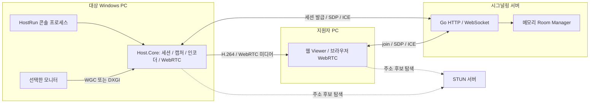
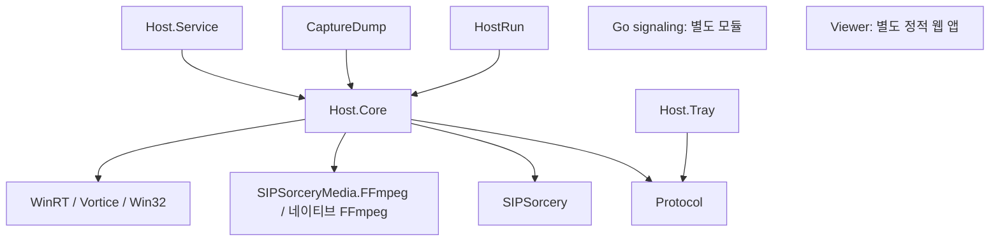
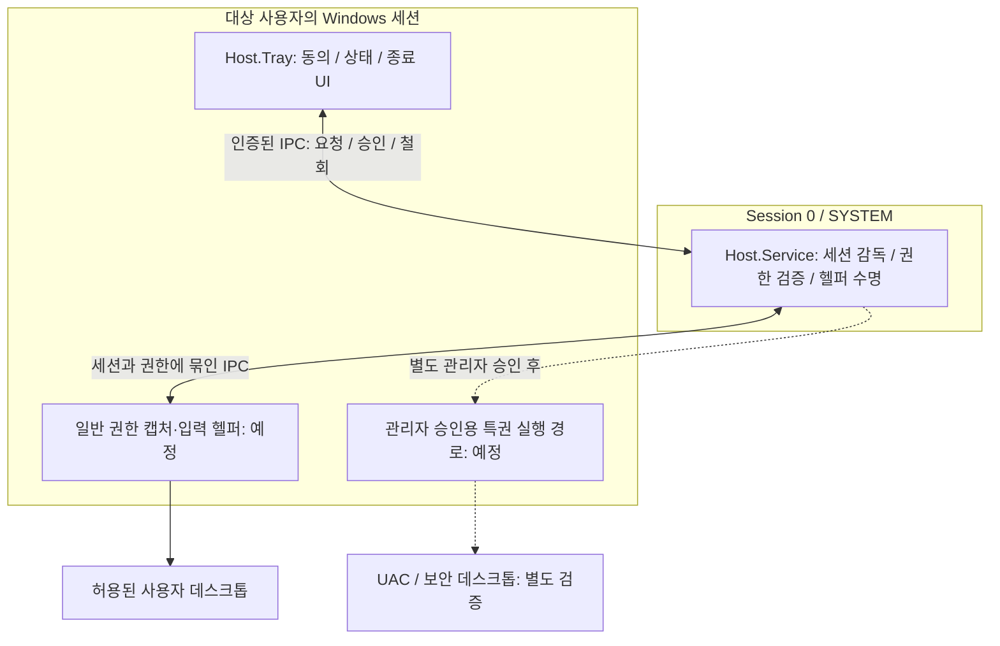

# 아키텍처

## E05 단일 PC 경계 실증 도구

`tools/RemoteAssist.BoundaryProbe`는 제품 원격 명령을 받지 않는 일회성 실증 서비스다. 승인된 설치 스크립트가 고유한 Program Files 하위 디렉터리에 해시 확인한 바이너리를 배치하고 SYSTEM 서비스로 실행한다. 서비스는 Session 0에 남고 WTS 사용자 토큰의 일반 헬퍼와 해당 콘솔 세션에 제한한 SYSTEM 실증 헬퍼를 각각 생성한다. 실행 대상은 자기 바이너리와 고정된 probe 모드뿐이다. 자식은 kill-on-close Job Object로 감독한다.

헬퍼는 관리자/SYSTEM과 대상 사용자만 접근하는 고유 Named Pipe로 결과를 전송한다. 서비스는 실제 client PID를 자신이 생성한 자식 PID와 대조한다. 수집하는 것은 계정 종류·세션·데스크톱·캡처 크기·프레임 해시이며 화면 원본을 저장하지 않는다. SYSTEM 헬퍼는 데스크톱 변경마다 새 스레드에서 input desktop을 연결한 뒤 DXGI 실증을 수행한다. 관찰은 제한 시간 뒤 끝나고 설치 스크립트가 서비스·보호된 임시 배치를 제거한다. 이 도구의 성공은 제품 승인/철회/IPC가 완성됐다는 뜻이 아니다. SAS·입력·사용자 전환은 별도 명시된 실증 결과로 판정한다.

보안 데스크톱의 입력은 캡처 성공과 독립적으로 실증한다. `DESKTOP_READOBJECTS|DESKTOP_WRITEOBJECTS`만 요청하면 SendInput이 error 5로 실패했다. 대상 데스크톱의 접근 범위를 `0x1FF`로 열었을 때 SYSTEM 헬퍼의 포인터 이동·복원이 성공했다. TokenUIAccess=0인 동일 경로도 성공해 UIAccess 부여 코드는 제거했다. 일반 사용자 토큰은 변경하지 않는다. 제품의 특권 헬퍼 생성에는 현재 세션의 독립 관리자 동의·짧은 lease·철회 감독을 추가해야 하며 이 probe 경로를 제품의 상시 권한으로 사용하지 않는다. 정식 설치본의 서명 검증은 E36에서 별도로 강제한다.

### 확정한 제품 책임과 IPC 경계

서비스는 활성 콘솔의 SID/Session ID와 설치 보호 경로의 바이너리를 검증하며 자식을 kill-on-close Job Object로 소유한다. 일반 사용자 UI/헬퍼가 캡처·인코더·WebRTC·일반 입력을 맡는다. 독립 관리자 승인이 유효할 때만 SYSTEM 특권 헬퍼를 같은 콘솔 세션에 만든다. 특권 헬퍼에는 화면 캡처·허용된 입력·SAS·고정 Runbook만 노출하며 임의 실행 파일·PowerShell 본문·경로를 받지 않는다.

서비스·Tray·헬퍼의 Named Pipe는 SYSTEM과 대상 SID로 보호하고 로컬 PID·토큰·세션·설치 파일을 대조한다. 접속마다 난수 nonce와 단조로운 세대·순번을 검사한다. 제어 JSON은 32KiB, 큐는 128개로 제한한다. 관리자 상태는 지원 세션/피어/권한 세대에 결합하며 500ms 갱신하는 1초 lease와 로컬 철회에 따른 즉시 종료를 적용한다. 사용자/SID 변경·로그오프·RDP 전환·서비스/일반 헬퍼 종료는 모든 승인을 폐기한다. 두 번째 계정이 없어 실제 사용자 전환은 후속 실증에 남기며 기존 동의를 새 사용자에게 전달하지 않는다.

특권 프레임은 인코딩 상한으로 먼저 축소하고 16MiB 슬롯 2개의 고정 shared mapping으로 일반 헬퍼에 전달한다. SYSTEM만 쓰고 대상 SID는 읽기만 허용한다. 각 슬롯의 크기·stride·모니터/권한 세대·순번을 검증하며 복사 전후 순번이 바뀌면 해당 프레임을 버린다. 슬롯이 가득 차면 오래된 프레임을 버리고 무한 큐를 만들지 않는다. 승인 철회/desktop 전환/종료 시 프레임·인코더 입력·공유 슬롯을 지우며 일반 헬퍼의 인증 IPC가 끊기면 미디어부터 중단한다. 이 단락은 후속 제품 구현의 기준이며 경계 probe가 shared mapping 또는 승인 흐름을 검증한 것으로 해석하지 않는다.

2026-10-08 구현 결정은 [제품 계약](product-contract.md)을 따른다. 단일 콘솔 사용자·별도 경로 pairing 신원·독립 권한·종료 최종 상태·시그널링 상실 fail-closed가 기준이다. 이후 코드 변경의 현재 상태는 루트 구현계획에서 관리한다.

[문서 안내](README.md) · [기술 사양](technical-specification.md) · [주요 로직](core-logic.md) · [워크플로우](workflows.md)

## 1. 제품 목표와 현재 실행 구조

RemoteAssist의 목표는 대상자가 허용한 범위 안에서 화면 보기, 원격 조작, 진단 작업을 제공하는 것이다. 현재는 HostRun 콘솔에서 화면 보기만 명시 승인받는 경로와 시그널링/Viewer 기반이 구현되어 있다. 서비스·Tray의 제품 동의 UI와 원격 제어는 미구현이다.

아래 그림은 현재 코드의 프로세스 경계다. Host.Service와 Host.Tray는 이 데이터 흐름에 아직 참여하지 않는다. STUN 서버는 주소 후보 수집을 돕고, Go 서버는 코드 발급과 협상 메시지를 처리한다.



Host와 Viewer를 같은 PC에서 실행하는 루프백 PoC도 가능하다. 하지만 실제 사용은 서로 다른 머신이며, NAT·드라이버·DPI·권한 차이는 루프백만으로 검증되지 않는다.

### 서버를 통과하는 것과 통과하지 않는 것

| 데이터 | 현재 경로 | 설명 |
|---|---|---|
| 코드/PIN/Host 토큰 발급 | Host → HTTP `/session` | 발급 응답은 Host만 받는다 |
| 참가 인증 | Host/Viewer → WebSocket `/ws` | 역할별로 다른 자격정보 사용 |
| SDP·ICE·종료 알림 | Host ↔ Go ↔ Viewer | 화면 자체가 아니라 연결 제어 메시지 |
| 화면 프레임 | Host → WebRTC → Viewer | Go 서버가 프레임을 보관하거나 디코딩하지 않음 |
| 웹 페이지·JS·CSS | 선택적으로 Go → 브라우저 | `RA_VIEWER_DIR` 설정 시 정적 파일 제공 |
| 마우스·키보드·파일·채팅 | 아직 없음 | 프로토콜 문서에는 목표 메시지가 있으나 채널은 미구현 |

목표 구조에는 TURN 경유 미디어 전달이 추가된다. 시그널링의 메시지 릴레이와 TURN의 미디어 릴레이는 서로 다른 기능이다.

## 2. 저장소와 프로젝트 의존성

```text
RemoteAssist.slnx                     C# 프로젝트 8개
Directory.Build.props                공통 TFM·컴파일 옵션
Directory.Packages.props             NuGet 버전 중앙 관리
src/
  RemoteAssist.Protocol/             SignalMsg, InputMsg JSON DTO
  RemoteAssist.Host.Core/            캡처·인코딩·시그널링·세션 조합
    Capture/                        WGC, DXGI, 모니터 열거, 프레임 타입
    Media/                          인코더 인터페이스, FFmpeg 로더·인코더
    Signaling/                      Host WebSocket/HTTP 클라이언트
  RemoteAssist.Host.Service/         Windows 서비스 골격
  RemoteAssist.Host.Tray/            WPF 일반 권한 UI 골격
tools/
  RemoteAssist.HostRun/              실제 화면 공유 PoC 실행 진입점
  RemoteAssist.CaptureDump/          캡처를 PNG로 확인하는 진단 도구
  RemoteAssist.SessionProbe/         사용자 세션·desktop 읽기 전용 진단
tests/RemoteAssist.Host.Core.Tests/  순수 회귀 실행 하네스
server/signaling/                    독립 Go 모듈과 테스트
web/viewer/                          index.html, app.js, app.css
deploy/                             signaling Dockerfile, coturn compose
third_party/ffmpeg/                  별도 확보할 네이티브 DLL 안내
docs/                               지속적으로 유지하는 개발자 문서와 프로토콜
docs_working/                       임시 개발 문서: 리뷰·조사·작업 메모·태스크 리스크
원격제어-구현계획.md                  단계별 태스크와 상태
```

아래 화살표는 **프로젝트 참조 방향**이다. 런타임 통신 화살표와 혼동하지 않는다.



`RemoteAssist.Protocol`은 플랫폼 중립 `net10.0`이다. 나머지 C# 프로젝트는 Windows용 TFM을 사용한다. Go 구조체와 JS 객체가 C# DTO를 참조하는 것은 아니다. 세 언어는 각각 [protocol.md](protocol.md)를 구현한다.

### 각 구성요소의 책임

| 구성요소 | 책임 | 맡지 않는 일 / 현재 한계 |
|---|---|---|
| HostRun | 옵션 해석, 세션 시작, 코드/PIN 표시, Ctrl+C 종료 | 설치형 제품 UI나 동의 창이 아님 |
| ScreenShareSession | 시그널링과 PC 생성, 캡처 스레드, 송신 파이프라인 | 화면 승인 게이트·종료 최종 상태; 서비스 기능은 미연결 |
| SignalingClient | HTTP 발급, Host join, JSON WebSocket 송수신 | TURN 발급·재접속·UI 처리 없음 |
| 캡처 클래스 | 지정 출력에서 BGRA 프레임 획득 | 인코딩·네트워크·사용자 동의 판단을 하지 않음 |
| FFmpegH264Encoder | 허용 H.264 후보 선택, BGRA 인코딩 | 후보별 Configure/출력 폴백·forceKeyframe/PLI/FIR |
| Go Room Manager | 코드별 룸, 자격정보, 슬롯, 만료 정리 | DB·분산 룸·영구 세션 기록 없음 |
| Go signaling | HTTP/WS 접수, 인증 호출, 피어 메시지 전달 | 미디어 디코딩·보관 없음 |
| Viewer | 이름·코드/PIN 입력, 승인 뒤 answer, 영상·통계 표시 | 원격 입력·동의 요청·파일/채팅 없음 |

## 3. 데이터와 자원의 소유권

현재 자원·작업·승인·종료의 상세는 [주요 로직](core-logic.md)을 따른다. Host 세션이 bounded 직렬 이벤트 큐, 수신/heartbeat/deadline Task와 캡처 스레드를 소유한다. 캡처·인코더는 같은 스레드에서 생성/사용/폐기한다. 로컬 승인 전에 PeerConnection과 캡처를 만들지 않는다. 종료는 최종 송신과 직렬화해 권한을 먼저 폐기한다. native hang의 헬퍼 프로세스 격리 감독은 미구현이다.

## 4. 목표 Host 구조 — 아직 미구현

제품에는 서비스와 사용자 UI의 역할 분리가 필요하다. 여기에 사용자 세션에서 캡처·입력을 실행할 헬퍼의 실행 위치를 명확히 해야 한다. SYSTEM 권한이 있다고 Session 0에서 로그인 사용자의 모니터와 입력에 자동 접근할 수 있는 것은 아니다.

아래는 **목표 책임 경계**이며, 실제 프로세스 개수·헬퍼 실행 파일·프레임 IPC·인코딩 위치는 T2.4/G03에서 확정할 사항이다. 현재 저장소에 이 헬퍼 프로젝트가 있는 것은 아니다.



설계에서 지켜야 할 경계는 다음과 같다.

- **UI:** Tray는 `asInvoker`를 유지한다. UI를 관리자 권한으로 실행하는 것으로 서비스 통신 인증을 대체하지 않는다.
- **세션:** 제어 대상 Windows Session ID를 명시한다. 콘솔 사용자와 RDP 사용자를 동일하게 취급하지 않는다.
- **IPC:** 파이프 이름을 안다는 이유만으로 승인이나 프레임을 신뢰하지 않는다. ACL과 상대 프로세스/세션 신원을 검증한다.
- **권한:** 화면 보기·일반 제어·관리자 권한을 분리한다. 일반 제어 동의만으로 승격 창에 입력하는 경로가 열리면 안 된다.
- **철회:** UI 종료·로그오프·사용자 전환·동의 철회를 세션 상태에 연결한다. 이전 세션 callback이 권한을 되살리지 못하게 한다.

`SetThreadDesktop`은 현재 프로세스 window station의 desktop을 지정하는 API이며 다른 Windows 세션으로 프로세스를 옮기는 기능이 아니다. Windows 세션 경계의 근거는 [Microsoft SetThreadDesktop](https://learn.microsoft.com/en-us/windows/win32/api/winuser/nf-winuser-setthreaddesktop)와 [Window Stations](https://learn.microsoft.com/en-us/windows/win32/winstation/window-stations)를 참고한다.

## 5. 제품 설계 원칙

1. 대상자의 명시적 동의와 즉시 종료를 우선한다. 현재 PoC의 무동의 송신은 개발용 한계이며 제품 정책이 아니다.
2. 세션에 승인된 기능만 수행한다. 관리자 조작은 별도 승인한다.
3. 운영 시그널링은 TLS/WSS를 사용하고, 미디어·데이터는 WebRTC의 암호화 경로를 유지한다.
4. 세션 시작·종료·권한 변경·파일 전송·Runbook 결과를 감사 이벤트로 남긴다. PIN과 인증 토큰은 로그에서 제외한다.
5. 초기 제품에 무인 상시 접속을 넣지 않는다. AI 조치도 사람의 승인 없이 실행하지 않는다.

이 원칙의 구현 상태는 [워크플로우의 목표 기능](workflows.md) 및 리뷰 G01/G03과 함께 확인한다.

## 6. 확장할 때 먼저 결정할 것

| 변경 | 선행 결정 |
|---|---|
| 서비스에 화면 공유 연결 | 사용자 세션 헬퍼, IPC 인증, 프로세스 종료·권한 철회 |
| 마우스·키보드 추가 | 전이 이벤트 신뢰성, key-up 복구, 좌표·DPI·모니터 계약 |
| TURN 도입 | 양쪽 ICE 설정, 단기 자격증명, 실제 relay 경로 검증 |
| 인코더 교체 | `IVideoEncoder` 계약, 포맷 변경과 키프레임, 실패 폴백 |
| 다중 세션/서버 확장 | 룸 소유권, 세션 라우팅, 재시작·재접속 정책 |
| Runbook/진단 추가 | 수집 범위·실행 권한·사용자 승인·감사·취소 |

현재 발견된 결함의 수정 순서와 완료 조건은 [리뷰·태스크 리스크](../docs_working/code-review-task-risks-2026-10-07.md)가 관리한다. 이 문서는 해당 태스크의 완료를 대신 선언하지 않는다.
