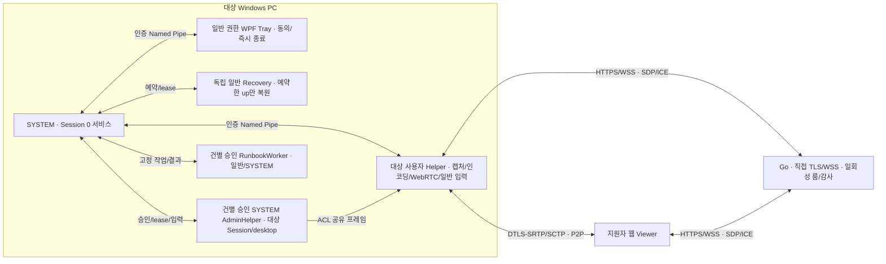

# 아키텍처

## 최초 실행 준비

2026-10-22부터 [최초 관리자 실행 기준](startup-preparation.md)을 따른다. 설치자는 최초 UAC로 확보한 권한으로 서비스와 프로그램별 방화벽 규칙을 준비한다. 서비스는 규칙과 헬퍼/세션 권한을 검증한 뒤 준비 신호를 기록한다. 대화형 실행에서 발급한 일회성 허가가 있으면 지원 코드를 자동 생성하고 인증한 첫 피어에 세션 전체 권한을 부여한다. 이 세션의 관리자 모드·등록 Runbook·파일 수신은 대상자의 추가 승인 창을 열지 않는다. 준비 누락을 세션 중 추가 UAC나 방화벽 허용 창으로 해결하지 않는다. 아래 건별 로컬 동의 설명은 일회성 허가 없는 기존 수동 지원 경로에 적용한다. 실제 원격 동작 수용은 별도다.

### 격리된 개발 시그널링 TLS 신뢰

보호 설치의 `host.settings.json`에 선택적으로 `SignalingCertificateBase64`(DER 인증서)를 지정할 수 있다. 지정하지 않으면 기존 OS 신뢰 검증을 사용한다. 지정하면 HTTPS/WSS 서버 인증서가 그 DER와 정확히 일치하고, 주소/SAN·유효기간·서버 인증 용도·사용자 지정 루트 체인을 통과해야 한다. 머신 인증서 저장소는 변경하지 않는다. 옵션은 보호된 설정과 인증된 Helper IPC로만 전달하며 원격 Viewer가 바꿀 수 없다. 개발 Viewer도 전용 임시 프로필의 단일 SPKI와 사전 주소/유효기간 검증으로 제한하고 전체 TLS 오류 무시는 금지한다. 제품 동의·권한·감사 조건은 동일하다.

구현 기준과 수용 상태는 구분한다. 기능/와이어는 [제품 계약](product-contract.md)·[프로토콜](protocol.md), 실행 수용은 [구현계획](../docs_working/원격제어-구현계획.md)의 V/F를 따른다.

## 실행 경계

2026-10-23 규격은 직접 P2P 전용이다. NAT 환경에서 직접 P2P 연결 성공은 제품의 필수 요구사항이며 연결 실패를 정상 제약이나 TURN 릴레이 폴백으로 처리하지 않는다. STUN/ICE 및 TLS 시그널링은 직접 연결 수립에 사용한다. 종전 TURN 관련 코드가 남아 있는 것과 현재 제품 지원 범위는 구별한다.

서비스는 Session 0에서 캡처하지 않는다. WTS로 확인한 단일 콘솔 Session/SID에 일반 Tray/Helper를 생성한다. Session 변경·RDP·로그오프·Tray/IPC 상실·서비스 재시작은 기존 승인을 폐기하고 모든 소유 자식을 종료한다. 새 사용자/피어가 승계하지 않는다.

설치 디렉터리는 Program Files/RemoteAssist/versions의 SYSTEM/Administrators 쓰기·Users 읽기 권한으로 보호한다. 실행 파일뿐 아니라 의존 DLL/스크립트/상위 디렉터리의 ACL·소유자·reparse 여부를 검사한다. Named Pipe는 로컬 전용이며 ACL과 상대 SID/Session/PID/보호 이미지·인스턴스 nonce를 결합한다. 일반 helper에는 범용 SYSTEM 실행 인터페이스가 없다.

## 소유권과 종료

ScreenShareSession이 bounded 직렬 상태 큐·시그널링 수신·heartbeat·협상/transport generation·캡처 스레드를 소유한다. 캡처/스케일러/인코더는 한 스레드에서 생성·사용·폐기한다. 오래된 PC/채널 callback은 세대/인스턴스 검사로 폐기한다. 최종 송신과 권한 철회를 직렬화하고 종료 상태는 되돌리지 않는다.

서비스의 Job이 일반/특권/Runbook helper를 소유한다. IPC heartbeat와 실제 영상 lease를 분리한다. 활성 화면의 첫 프레임은 15초, 이후 실제 송신 정지는 3초 deadline으로 감독하고 hung native helper를 Job 종료로 격리한다. 로컬 즉시 종료는 이 deadline을 기다리지 않고 소유 Job을 종료한다. Recovery는 별도 Job에서 down 전에 ACK한 키/button/Unicode up만 복원하며 helper/서비스 상실·lease 만료를 감시한다. managed cleanup은 5초 상한이고 살아 있는 native 객체를 다른 스레드에서 Dispose하지 않는다.

서비스의 session.gate 독점 파일 잠금은 지원 수명 전체에 유지된다. 업데이트/제거는 이 잠금을 얻어야 한다. 종료 시 새 작업과 송신/입력을 막고 독립 복원·자원 정리를 수행한 뒤 lease를 해제한다. 감사 실패가 종료를 막지 않는다.

서비스 강제 종료 시 독립 SYSTEM Recovery가 인증된 서비스 handle의 사망을 확인한다. 먼저 입력 생산자를 차단하고 예약 up을 복원한 뒤 실제 session/connection의 종료 감사를 기록한다. 정상 종료와 Recovery는 동일한 `AppendSessionEndedOnce`를 사용한다. 보호 audit 디렉터리의 배타 파일 handle을 프로세스 간 mutex로 사용하며 대기는 2초로 제한한다. 모든 append/회전 및 Reporter ACK를 직렬화한다. current·3개 회전 파일과 pending spool에서 기존 종료 EventId를 찾고 spool만 남았으면 같은 EventId/Utc로 저널을 보충한다. 파손·경로 검증 실패는 감사 실패이며 입력 복구 결과와 구분한다.

## 미디어와 입력

안정된 모니터 identity/geometry를 승인에 묶는다. WGC 우선이며 미지원 때 동일 모니터의 DXGI 폴백만 허용한다. BGRA 크기/stride/세대를 검사하고 방향을 유지해 짝수 크기로 축소한다. DXGI는 회전/커서 합성을 처리한다. 모니터 제거는 종료이고 배치/해상도 변경은 새 현장 승인 후 capture/staging/scaler/encoder 재구성과 IDR/geometry ACK로 재개한다.

FFmpeg 8.1 공유 LGPL DLL만 hash 검사 후 고정 경로에서 로드한다. 허용 HW 후보→libopenh264 순서로 실제 시험 출력을 확인하며 libx264/GPL/nonfree/PATH 폴백은 금지한다. constrained baseline SDP/실제 SPS profile·level과 peer 한도를 일치시킨다. monotonic 90kHz RTP sample time과 mode1 NAL/FU-A를 사용하고 SRTP/SSRC/sequence는 SIPSorcery가 소유한다.

입력은 reliable ordered input/pointer를 분리한다. pointer move는 최신 값만 합치며 key/button/text/reset 전이는 유실시키지 않는다. 상대 0..1 좌표는 승인 모니터의 물리 픽셀·가상 desktop으로 환산한다. 순번/topology/inputEpoch/barrier로 오래된 입력을 거부하고 reset ACK 뒤에만 새 epoch를 재개한다. 로컬 승인 UI·포커스 이탈·권한 변경 시 입력을 해제한다.

## 특권·보조 기능

관리자 초기 capability는 요청 가능 범위이며 활성 권한이 아니다. Tray의 별도 만료 승인에만 서비스가 대상 Session의 SYSTEM AdminHelper를 실행한다. 특권 capture 프레임은 ACL·세대·geometry·commit을 검사한 두 슬롯 mapping으로 전달한다. 관리자 입력은 승인된 batch만 전달한다. SAS와 보안 desktop 종료/복귀는 별도 게이트를 따른다. 관리자 철회는 전체 지원 종료로 처리한다.

FileTransferSession은 로컬 경로/수락·한 건·16KiB 순번 청크·credit 배압·SHA-256·안전한 NTFS handle/충돌·부분 파일 정리를 소유한다. 감사 ACK 없이는 필수 전이를 진행하지 않는다. FeatureDataChannel은 chat/clipboard를 독립 검사한다. 클립보드는 명시 get/set과 hash/로컬 UI actor를 사용한다. DiagnosticsSession은 읽기 전용 provider의 상한/오류/취소와 영상 없는 모드를 제공한다.

Runbook은 고정 embedded source/hash와 허용 인자 enum만 사용한다. Tray에 실제 전문과 영향·권한을 보여 건별 승인한다. 별도 Job의 worker가 보호 설치/hash를 다시 검사하고 고정 PowerShell에서 최대20초/출력4096자 한도로 실행한다. 취소는 이미 발생한 효과를 되돌린다는 뜻이 아니다. 원격 임의 셸은 제공하지 않는다.

## 연결·운영·업데이트

인증된 같은 피어의 일시 ICE 단절만 2초 후 새 PeerConnection/DTLS/SCTP generation으로 복구한다. 시그널링/승인/IPC 상실 또는 관리자·건별 승인 중 복구는 전체 종료다. 연속 최대3회/각30초, 성공 후8분 TURN credential 갱신이며 이전 전송/입력은 차단한다. TURN allocation·다른 NAT 성공은 V/F에서 따로 확인한다.

Go 서버는 bounded 룸/연결/발급/메시지·일회성 pairing·정확한 Origin·CSP·TLS 설정과 WS shutdown deadline을 적용한다. 운영 node 인증으로 감사와 metrics를 제공한다. Host의 보호 spool은 서버 fsync ACK 이후만 삭제한다. payload/화면/클립보드/Runbook 출력/비밀 키를 감사에 넣지 않는다.

자체 포함 Host와 별도 LGPL DLL을 Authenticode로 서명하고 고정 manifest의 ZIP/hash를 RSA-PSS/SHA256으로 검증한다. 유휴 gate→보호 staging→원자 pending transaction→SCM image 변경→45초 dependency/설정 ready→commit 순서다. 실패/중간 종료는 직전 정상 image로 rollback한다. root bootstrap은 protocol1 recovery를 유지하며 자동 업데이트는 현재 검증된 버전 updater로 전달한다. 실제 서명·VM 설치/전원 차단·운영 endpoint 수용은 V36/V37이다.
