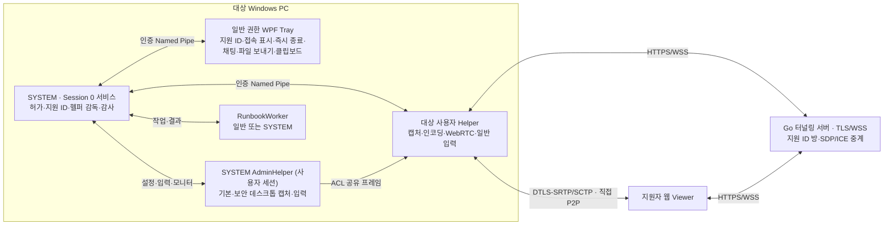

# 아키텍처

신뢰 모델과 기능 범위는 [제품 계약](product-contract.md), 와이어 포맷은 [프로토콜](protocol.md)이 기준이다.

## 실행 경계

터널링 서버는 지원자 PC(A)가 여는 접속 지점이다. 대상 PC는 설치 때 받은 A의 주소(`TunnelUri`)로 직접 접속하고, 브라우저는 포트를 열 수 없으므로 이 서버가 Viewer 페이지 제공과 첫 SDP/ICE 교환을 맡는다. 화면·입력은 이 서버를 거치지 않고 두 PC가 직접 주고받는다. 예전 이름은 "시그널링"이다.

서비스는 Session 0에서 캡처하지 않는다. WTS로 확인한 단일 콘솔 Session/SID에 Tray와 Helper를 만든다. 사용자가 바뀌면 지원 허가를 없애고 모든 자식을 끝낸다.

## 지원 허가와 지원 ID

- 대상자가 `RemoteAssist.Update.exe`(정식: `support`, 개발: `support-dev`)를 관리자 권한으로 실행하면 `ProgramData/RemoteAssist/initial-support.json`에 허가를 쓴다. 허가는 콘솔 사용자 SID·Windows 세션·로그온 시각에 묶인다. 파일 ACL은 SYSTEM/Administrators만 허용한다.
- 서비스는 시작할 때마다 허가를 읽는다(`InitialSupportLaunch.Load`). 같은 로그온(사용자·세션·로그온 시각)이면 유지되므로 서비스 재시작·업데이트 뒤에도 지원이 이어진다. 재부팅·로그오프·사용자 변경이면 지운다.
- 대상자의 즉시 종료·Tray 종료·사용자 변경은 허가를 지운다(`StopSupport`).
- 지원 ID는 `ProgramData/RemoteAssist/device-id.txt`의 고정 9자리다. Helper는 매 세션 `POST /session {"code":<지원 ID>}`로 같은 방 번호를 연다.

## 세션 수명

1. 허가가 있고 Helper가 없으면 서비스가 Helper를 띄운다(`StartHelper`). Helper는 터널링 서버 방을 열고 지원자를 무기한 기다린다.
2. 지원자가 들어오면 Helper가 바로 전 권한(`PermissionGate.Grant`)으로 PeerConnection과 모든 기능 채널을 만든다. 승인 단계는 없다.
3. Viewer는 연결 직후 관리자 모드를 요청한다. 서비스가 AdminHelper를 띄우고, 이후 화면과 입력은 AdminHelper를 거친다(일반·상승 창·UAC·잠금 화면을 한 경로로 처리).
4. 지원자가 나가면 세션이 끝나고 서비스는 1초 뒤(시작 실패가 이어지면 5초 뒤) 새 Helper를 띄운다. 터널링 서버가 내려가 있어도 재시도한다.

### 일반·관리자 이중 구조의 결정

일반 Helper(사용자 토큰)는 UIPI 때문에 상승 창·보안 데스크톱에 입력할 수 없다. 대상자가 이미 관리자 실행으로 허가했으므로, 연결되면 항상 관리자 모드로 들어가 SYSTEM AdminHelper가 현재 입력 데스크톱을 따라가며 캡처·입력한다. WebRTC·인코딩은 일반 Helper에 남긴다(네트워크·코덱을 SYSTEM 프로세스에 두지 않기 위해). 관리자 헬퍼 시작이 실패하면 일반 모드로 계속하고 Viewer는 다시 시도할 수 있다. 확인한 GPU 조합과 미시험 항목은 [실연결 현재 상태](live-e2e-test.md#9-현재-상태와-남은-과제)를 따른다.

## 소유권과 종료

- `ScreenShareSession`이 직렬 이벤트 큐·터널링 서버 수신·heartbeat·연결 generation·캡처 스레드를 소유한다. 캡처·스케일러·인코더는 캡처 스레드 하나에서 만들고 쓰고 버린다. 오래된 PeerConnection·채널 callback은 generation 검사로 버린다.
- 서비스의 Job이 Helper·AdminHelper·RunbookWorker를 소유한다. 헬퍼가 멈추면 Job 종료로 정리한다. 입력은 Helper 안의 `InputSession`이 눌린 키·버튼을 추적해 정지·일시 중단 때 떼고, AdminHelper는 데스크톱을 떠날 때 자기가 누른 키를 뗀다.
- `session.gate` 파일 잠금은 지원자가 연결된 동안만 잡는다. 업데이트 설치는 연결이 없을 때 진행한다.
- 감사 기록(`AuditJournal`)은 지원을 막지 않는다. 기록 실패는 `service-status.ndjson`에 남긴다.

## 미디어와 입력

- 모니터 identity/geometry를 세션에 묶는다. WGC 우선, 초기화 실패 때 같은 모니터의 DXGI를 쓴다. 해상도·배치가 바뀌면 같은 모니터(없으면 주 모니터)로 자동으로 다시 맞춘다.
- 관리자 모드 중에도 모니터를 바꿀 수 있다. Helper가 입력 좌표 기준을 옮기고 AdminHelper에 `admin-monitor`로 새 모니터를 알린다.
- 관리자 모드가 아닐 때 보안 데스크톱(UAC·잠금)이 뜨면 세션을 끊지 않고 마지막 화면을 유지한다.
- FFmpeg 8.1 LGPL DLL만 hash 검사 후 고정 경로에서 로드한다. 후보는 nvenc → qsv → amf → mf → openh264 순서이며 libx264는 금지다.
- 입력은 input/pointer 채널을 분리하고 순번·inputEpoch·barrier로 오래된 입력을 거부한다. 좌표는 0~1 정규화다.

## 보조 기능

- 파일: 한 번에 한 건, 16KiB 청크, credit 배압, SHA-256, NTFS handle 기반 원자 확정. 수신 파일은 대상 사용자 다운로드 폴더 아래 `RemoteAssist`에 저장하며 기존 파일을 덮어쓰지 않는다.
- 클립보드·채팅·진단은 각자 상한을 둔 채널이다.
- Runbook: 등록 작업(고정 source/hash)과 원격 PowerShell 명령. 서비스가 일반 또는 SYSTEM worker Job으로 실행하며 20초·출력 상한이 있다.

## 연결 복구

일시 ICE 단절이 2초 이어지면 Host가 같은 터널링 서버 위에서 다음 generation offer로 전송을 다시 만든다(최대 3회). 터널링 서버가 끊기거나 지원자가 나가면 세션을 끝내고 Host가 같은 지원 ID로 다시 대기한다.

## 설치·업데이트

정식 설치는 Program Files/RemoteAssist/versions의 보호 ACL 경로다. Authenticode 서명 Host, RSA-PSS 서명 manifest/ZIP 검증, pending transaction → 서비스 image 전환 → ready → commit 순서이며 실패하면 직전 버전으로 rollback한다. 개발 설치(Program Files/RemoteAssist-Dev)와 빌드 출력 실행은 개발 모드로 보고 보호 경로 ACL·릴리스 manifest 검사를 생략한다. 정식 설치 검사는 배포 단계에서 다시 검토한다.

## 코드 읽기

아래 경로에서 `Host.*`는 `src/RemoteAssist.Host.*`, `Service/`는 `src/RemoteAssist.Host.Service/`, `Deployment/`·`Media/` 등은 `src/RemoteAssist.Host.Core/` 아래다.

| 코드 | 책임 |
|---|---|
| Host.Service/HostSessionSupervisor | 콘솔 Session/SID·지원 허가 읽기/폐기·Tray/Helper/AdminHelper/Runbook Job 감독·자동 재대기·감사(실패해도 계속) |
| Deployment/InitialSupportLaunch, DeviceId | 관리자 실행 허가(로그온 시각·사용자·세션 결합)와 고정 지원 ID |
| Deployment/InstallationState, StartupPreparation | 정식/개발 모드 구분, 보호 경로·manifest 검사(정식만), 방화벽 준비 검증 |
| Windows/SessionProcess, ProtectedInstallation | WTS 실행·고정 역할/이미지·토큰·Job |
| Ipc/LocalIpcEndpoint, IpcPeerSession | 로컬 ACL·PID/SID/Session/nonce 인증·크기/순번·heartbeat |
| Security/PermissionGate, AdminAuthorization | 연결된 지원자에게 전 권한 부여·세션 종료 뒤 차단, 관리자 세대 |
| ScreenShareSession | 직렬 이벤트·generation·PeerConnection/채널·캡처 스레드·모니터 전환·데스크톱 전환·전송 재구성·멱등 종료 |
| Capture/WgcScreenCapture, DxgiScreenCapture | 같은 모니터 identity·BGRA/stride·geometry·rotation/cursor |
| Media/BgraFrameScaler, FFmpegH264Encoder | 재사용 버퍼·짝수 출력·후보별 실제 init/SPS·키프레임 |
| Media/H264Contract, FrameRtpClock, H264RtpPayloads | SDP profile/level·단조 90kHz·NAL/FU-A |
| Input/InputSequenceGuard, InputDataSession, InputSession | 채널별 순번/barrier/epoch·move 합치기·눌린 키 추적과 해제·일시 중단/재개 |
| Security/AdminDesktopRuntime, AdminFrameSource, Service/AdminScope | 현재 입력 데스크톱 추적 캡처·입력, 모니터 재바인딩, 공유 프레임 |
| Files/FileTransferSession, DownloadFolder | 한 건·credit·SHA256·NTFS handle 확정·다운로드 폴더 자동 저장 |
| Media/FeatureDataChannel, Diagnostics | chat/clipboard/진단 한도 |
| Runbooks, Media/RunbookDataSession, Service/RunbookScope | 등록 작업·원격 명령·worker Job·20초/출력 상한 |
| Security/AuditJournal, Service/AuditReporter | 폐쇄 metadata 저널·선택적 서버 보고 |
| RemoteAssist.Update, deploy/install.ps1 | 관리자 실행 진입점(support/support-dev)·서명 설치/업데이트·rollback |
| Go room/tunnel | 지원 ID 방·ACK 원자성·역할·재협상 세대·Viewer 교체·상한·TLS |
| Viewer connection/input/features/files/runbooks/app | 연결 객체·자동 관리자 모드·자동 재접속·좌표·파일·원격 명령 UI |

캡처 스레드는 모니터·품질 변경을 프레임 경계에서 적용한다. 일반 모드 모니터 전환은 캡처 스레드가 새 캡처를 만들고 첫 프레임을 보낸 뒤 완료되고, 관리자 모드 전환은 AdminHelper가 다음 데스크톱 루프에서 새 모니터를 연다. 두 경우 모두 입력을 멈췄다가 새 epoch로 재개한다.

EndSession은 최종 송신과 직렬화해 권한·큐를 먼저 폐기하고 Completion 원인을 한 번 확정한다. Dispose는 native thread/task 종료를 기한 안에서 기다리며 실행 중인 native 객체를 먼저 해제하지 않는다. 서비스는 헬퍼 crash/hang·IPC 상실에서 Job을 끝내고 허가가 있으면 다시 대기한다.

감사 로그는 고정 kind/ID/결과 metadata만 쓴다. 예외 본문·token·클립보드·파일 경로·스크립트 출력은 감사에 없다.
