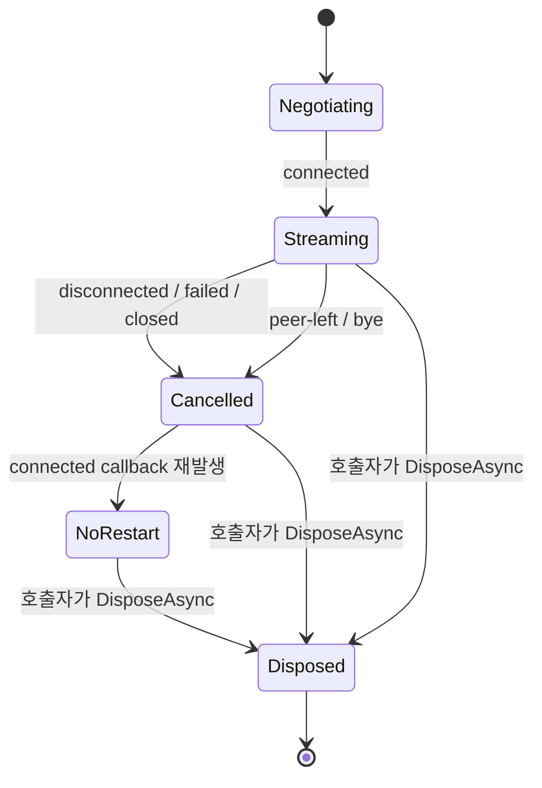
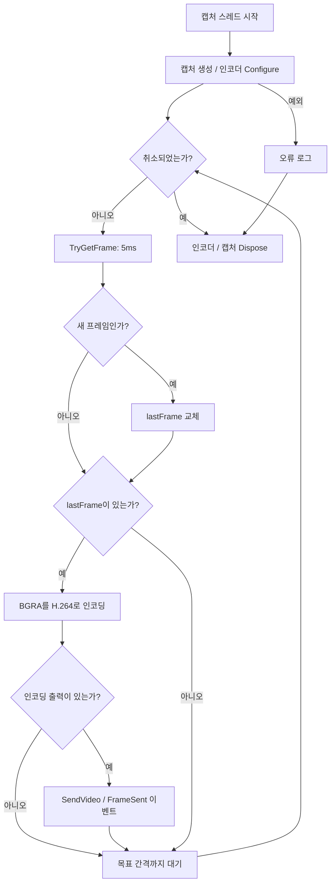

# 주요 로직과 코드 읽기 안내

[문서 안내](README.md) · [아키텍처](architecture.md) · [워크플로우](workflows.md)

현재 동작을 이해할 때는 HostRun에서 시작해 세션, 캡처·인코더, 서버, Viewer 순서로 읽는 것이 좋다. 인터페이스에 적힌 목표와 구현된 메서드의 행동이 다른 부분은 아래에 별도로 표시한다.

## 1. 코드 탐색 지도

| 알고 싶은 내용 | 첫 파일 / 심볼 |
|---|---|
| 프로그램 시작·옵션·코드 표시 | [HostRun/Program.cs](../tools/RemoteAssist.HostRun/Program.cs) |
| 전체 화면 공유 조합 | [ScreenShareSession.cs](../src/RemoteAssist.Host.Core/ScreenShareSession.cs), `StartAsync` |
| Host의 HTTP/WS 통신 | [SignalingClient.cs](../src/RemoteAssist.Host.Core/Signaling/SignalingClient.cs) |
| 공통 프레임·모니터 타입 | [IScreenCapture.cs](../src/RemoteAssist.Host.Core/Capture/IScreenCapture.cs) |
| 사용자에게 보이는 모니터 번호 | [Monitors.cs](../src/RemoteAssist.Host.Core/Capture/Monitors.cs) |
| 기본 캡처 | [WgcScreenCapture.cs](../src/RemoteAssist.Host.Core/Capture/WgcScreenCapture.cs) |
| WinRT/COM 연결 | [WgcInterop.cs](../src/RemoteAssist.Host.Core/Capture/WgcInterop.cs) |
| DXGI 대체 캡처 | [DxgiScreenCapture.cs](../src/RemoteAssist.Host.Core/Capture/DxgiScreenCapture.cs) |
| DLL 탐색·초기화 | [FFmpegLoader.cs](../src/RemoteAssist.Host.Core/Media/FFmpegLoader.cs) |
| 코덱 선택·인코딩 | [FFmpegH264Encoder.cs](../src/RemoteAssist.Host.Core/Media/FFmpegH264Encoder.cs) |
| 서버 시작·환경 변수 | [signaling/main.go](../server/signaling/main.go) |
| 룸 생성·슬롯·만료 | [room.go](../server/signaling/internal/room/room.go) |
| WebSocket 핸들러·릴레이 | [server.go](../server/signaling/internal/signaling/server.go) |
| 브라우저 연결·영상·통계 | [app.js](../web/viewer/app.js) |
| 현재 서버 테스트 | [server_test.go](../server/signaling/internal/signaling/server_test.go) |

## 2. HostRun과 세션 시작

HostRun은 시작 시 DPI awareness를 설정하고 콘솔 logger와 옵션을 만든다. `--encoder-check`가 있으면 네트워크 세션을 열지 않고 인코더 검사 경로로 들어간다. 그 외에는 모니터 목록을 출력하고 `ScreenShareSession`을 만든다.

`ScreenShareSession.StartAsync`의 현재 순서는 다음과 같다.

1. `POST /session`으로 `SessionCredentials`를 받는다.
2. `SignalingClient.ConnectAsync`가 `/ws`에 접속해 Host token으로 join한다.
3. 첫 응답이 `joined`인지 확인하고 `peerPresent`를 돌려준다.
4. 호출자 토큰에 연결된 CTS를 만들고 시그널링 수신 Task를 시작한다.
5. Viewer가 먼저 있었다면 직접 협상한다. 아니면 `peer-joined`를 기다린다.
6. 자격정보를 반환하면 HostRun이 코드/PIN을 출력하고 Ctrl+C를 기다린다.

`StartAsync` 완료는 **Viewer 영상 표시 완료가 아니다.** 서버 참가까지 성공했다는 뜻이며, 인코더 생성은 WebRTC `connected` 이후에 일어난다. 따라서 미디어 초기화 실패가 `StartAsync` 호출자에게 자동으로 전달되는 구조가 아니다(R07).

### 시그널링 클라이언트

`SignalingClient`는 세션 발급용 HttpClient와 장기 연결용 ClientWebSocket을 사용한다. 서버 URI가 HTTPS면 WSS, 그 외에는 WS를 만든다. `/session`과 `/ws`는 원점 기준 절대 경로이므로 URL prefix 하위에 배포하려면 별도 검토가 필요하다.

송신은 JSON 직렬화 후 `SemaphoreSlim`으로 직렬화한다. DTO 필드명은 `[JsonPropertyName]`, 자격정보 응답은 camelCase naming policy로 맞춘다. 수신은 64KiB 버퍼로 조각을 읽어 문자열로 합친다. 이는 전체 메시지 상한 64KiB라는 뜻이 아니며, UTF-8 조각 디코딩과 상한 처리는 R14 보완 대상이다.

## 3. 협상과 연결 상태

Host는 offer를 만드는 쪽이다. `NegotiateAsync`는 PC가 없을 때 생성하고 H.264 SendOnly 트랙을 붙인 뒤 local SDP 설정과 offer 송신을 수행한다. Viewer의 answer를 받으면 `setRemoteDescription`을 호출한다. ICE는 양쪽 callback에서 별도 메시지로 전달한다.

| 입력 이벤트 | 현재 처리 | 중요한 한계 |
|---|---|---|
| `peer-joined` | `NegotiateAsync` | 중복/경쟁을 막는 상태 전이 락 없음 |
| `answer` | remote SDP 적용 | 실패 시 로그만 기록 |
| `ice` | PC에 candidate 추가 | SDP 준비 전 후보 보관 없음 |
| `peer-left` / `bye` | `StopStreaming` | 세션 CTS 취소, 전체 자원 정리와 동일하지 않음 |
| `error` | 오류 로그 | 자동 종료·호출자 실패 전달 없음 |
| 수신 EOF | 루프 탈출 | 미디어 작업을 함께 종료하지 않음 |

아래 상태도는 현재 `onconnectionstatechange`와 캡처 작업의 관계를 설명한다. enum으로 구현된 통합 상태 머신은 아니다.

`Cancelled`에서 `_captureThread` 참조는 남고 CTS는 취소된 채다. 그래서 일시 단절 복구 시 `StartStreaming`이 다시 불려도 재개하지 않는다(R08). 정상 수명주기 구현을 추가할 때는 세션 토큰과 스트리밍 작업 토큰을 분리하고, terminal 상태에서 늦은 이벤트가 세션을 되살리지 못하게 해야 한다.

## 4. 화면 캡처

### 공통 프레임 계약

`IScreenCapture.TryGetFrame(timeout, out frame)`은 새 프레임을 받으면 true를 반환한다. false는 정적 화면이나 일시적인 재설정에서도 발생하며, 현재 인터페이스만으로 모든 사유를 구분할 수 없다.

| 타입/필드 | 의미 |
|---|---|
| `CapturedFrame.Bgra` | 캡처 객체의 재사용 배열을 가리키는 ReadOnlyMemory |
| `Width`, `Height`, `Stride` | 프레임 실제 픽셀 크기와 줄 간격 |
| `AccumulatedFrames` | 캡처 API가 보고하는 누적 프레임 정보 |
| `DirtyRectCount`, `DirtyBounds` | 변경 영역 진단 정보; 인코딩 최적화에 미사용 |
| `MonitorInfo` | 인덱스, 장치명, 가상 화면 좌표, 크기, 주 모니터 여부, HMONITOR |

프레임을 반환했다고 캡처 내부 배열의 소유권이 호출자로 넘어오지 않는다. 다음 캡처 호출 전에 소비해야 하며, 비동기 큐에 넣는 구조로 바꿀 때는 반드시 버퍼 수명 계약을 새로 정해야 한다.

### WGC 경로

1. `Monitors.Get`으로 공통 목록의 모니터를 선택한다.
2. D3D11 device/context를 만들고 WinRT Direct3D device로 감싼다.
3. HMONITOR로 `GraphicsCaptureItem`을 만든다.
4. `CreateFreeThreaded` 프레임 풀과 capture session을 생성한다.
5. `TryGetNextFrame`을 폴링한다.
6. surface에서 D3D texture를 얻어 staging으로 복사한다.
7. staging을 Map하고 RowPitch에 맞춰 관리 배열로 복사한 뒤 Unmap한다.

RowPitch가 영상 폭×4와 같으면 한 번에 복사하고, 다르면 줄마다 padding을 건너뛴다. 프레임 크기 변경을 발견하면 staging과 pool을 재생성하고 해당 프레임은 버린다. 현재는 이 변경이 인코더까지 전달되지 않는다(R02).

`CreateFreeThreaded`는 DispatcherQueue 없이 프레임을 받을 수 있게 하는 선택이다. 그것이 Session 0에서 사용자 화면을 캡처하게 해주는 것은 아니다.

### DXGI 경로

DXGI는 어댑터와 출력을 열거하고 선택한 출력의 어댑터로 D3D11 device를 생성한 뒤 `DuplicateOutput`을 호출한다. 프레임 획득 후 texture를 staging으로 복사해 읽으며 `finally`에서 resource와 프레임 점유를 해제한다.

| 결과 | 현재 행동 |
|---|---|
| `DXGI_ERROR_WAIT_TIMEOUT` | false 반환 |
| `DXGI_ERROR_ACCESS_LOST` | duplication을 폐기하고 다음 호출에 재생성 시도 |
| 기타 HRESULT 오류 | 예외 발생 |
| 정상 프레임 | Map/복사/Unmap, dirty rect 읽기, 반환 |

AccessLost 재생성이 항상 성공하는 것은 아니다. 출력 크기·회전·모니터 식별·커서 합성의 부족은 R02~R04에서 추적한다. WGC와 DXGI의 현재 monitor index 계산법도 다르다.

## 5. 인코딩과 송신 루프

`FFmpegLoader.Initialise`는 정적 lock으로 초기화를 한 번 수행하고 `LoadedFrom`을 기록한다. `FFmpegH264Encoder` 생성자는 허용 후보를 순서대로 `SetCodec`에 전달한다. 선택 후 `Configure`에서 크기·FPS·비트레이트를 설정하고 실제 인코더를 연다.

이 두 단계는 아직 하나의 폴백 트랜잭션이 아니다. 후보 이름 선택은 성공해도 Configure가 실패할 수 있으며, 그때 다음 후보를 선택하지 않는다(R01). `IVideoEncoder` 인터페이스는 있지만 ScreenShareSession 필드는 현재 구체형 `FFmpegH264Encoder`다. 테스트용 인코더 주입이나 다른 구현으로의 교체에는 조립 지점 보완이 필요하다.

루프는 목표 간격에서 해당 회차 처리 시간을 빼고 남은 시간만 `Thread.Sleep`한다. 처리 자체가 오래 걸리면 목표 FPS보다 느려진다. 인코더가 빈 출력을 반환하는 프레임은 송신·FrameSent 카운터에 포함하지 않는다.

`Encode`는 BGRA 메모리를 배열로 복사해 FFmpeg에 넘긴다. `forceKeyframe`은 현재 무시된다(R13). 세션에서는 최초 포맷으로만 Configure하고 새 프레임의 크기·stride를 소비하지 않는다(R02). 따라서 해상도 변경을 “캡처 클래스에서 처리했으니 전체 완료”라고 판단하면 안 된다.

## 6. 서버의 룸과 연결 처리

`Manager`는 `map[string]*Room`을 보유한다. `Room`은 자격정보, 생성/만료 시각, Host/Viewer 포인터를 가진다. Manager와 Room은 각각 mutex를 사용한다. `room.Conn` 인터페이스는 전송 수단을 Room으로부터 분리하는 경계다.

`handleWS`는 다음 순서로 실행한다.

1. Origin 정책에 따라 WebSocket을 수락하고 read limit을 건다.
2. 10초 안에 첫 join 메시지를 읽는다.
3. 룸 조회와 만료 검사 후 역할별 자격정보를 비교한다.
4. 역할 슬롯에 Peer를 넣고 종료 시 `leave`하도록 defer를 등록한다.
5. 참가자에게 `joined`, 기존 참가자에게 `peer-joined`를 보낸다.
6. `offer/answer/ice/bye`를 반대편으로 릴레이한다.
7. 읽기 오류나 bye로 끝나면 슬롯을 비우고 반대편 통지, 빈 룸 삭제를 시도한다.

송신 직렬화는 `wsConn`의 크기 1 채널로 한다. 이는 두 JSON 전송이 섞이지 않도록 하는 장치다. join ACK 순서나 룸 수명주기 전체를 직렬화하지 않으므로 R05/R12의 논리 경쟁은 별도로 해결해야 한다.

TTL sweeper는 아무도 없는 만료 룸을 매분 청소한다. 이와 달리 `Manager.Get`의 만료 조회는 활성 룸도 맵에서 제거한다. 룸 맵 삭제와 이미 실행 중인 핸들러가 가진 Room 포인터의 수명은 서로 다르다.

## 7. Viewer 로직

Viewer는 하나의 JS module에서 DOM 참조와 전역 `ws`, `pc`, `statsTimer`를 관리한다. 프레임워크·번들러·상태 관리 라이브러리는 없다.

| 함수 | 현재 역할 |
|---|---|
| submit handler | 숫자만 남겨 코드 9자리/PIN 최소 4자리 검사 후 connect |
| `connect` | 같은 origin의 `/ws` 연결, Viewer join, 메시지 분기 |
| `handleOffer` | PC 생성, remote SDP 적용, answer 생성·송신 |
| `ontrack` | stream 또는 track으로 MediaStream을 만들고 video에 연결 |
| `startStats` | 1초마다 getStats, 수신 해상도/FPS/비트레이트/경로 표시 |
| `teardown` | 타이머·PC·열린 WS 정리, 영상 제거, 입력 폼 복귀 |

비트레이트는 `(bytesReceived 차이 × 8) / (timestamp 차이(ms))`로 kbps를 계산한다. FPS나 해상도는 브라우저가 제공할 때만 표시한다. 후보 경로는 nominated/succeeded pair의 **local candidate**만 보고 판단하므로 모든 TURN 경로를 정확히 구분하지 못한다.

`ontrack`은 track이 연결되었다는 신호이며 영상 프레임이 실제 디코딩되었다는 보장은 아니다. 화면 전환만 보고 E2E를 통과 처리하지 말고 프레임 수신·표시를 확인한다.

연속 connect나 teardown과 async 협상이 겹치면 이전 callback이 전역 변수의 새 객체를 조작한다(R09). 수정 시 연결 시도별 소유 객체와 generation을 도입하는 것이 핵심이다.

## 8. 종료와 오류를 읽을 때의 주의점

현재 `StopStreaming`, `DisposeAsync`, Viewer `teardown`, 서버 `leave`는 하나의 원자적 종료 동작이 아니다. 서로 다른 계층이 별도 정리를 한다. 따라서 “한쪽에서 닫았으니 모든 자원이 이미 닫혔다”는 전제를 두지 않는다.

| 사건 | 현재 위험 | 리뷰 |
|---|---|---|
| 시그널링 EOF/예외 | 미디어가 계속될 수 있음 | R07 |
| 캡처/인코더 오류 | 로그만 남고 PeerConnection과 호출자는 대기 | R07 |
| 일시 연결 단절 | 전체 CTS 취소, 재시작 불가 | R08 |
| 네이티브 작업 지연 | Join timeout 후 공유 자원 정리 경쟁 | R11 |
| close 응답 미수신 | 전체 종료 상한 없음 | R11 |
| 인증 실패 후 WS close | 구체적인 오류 문구가 덮임 | R16 |

수정 작업에는 가짜 캡처·인코더·시그널링, 수동 완료 Promise, barrier, 가짜 시계를 사용해 이벤트 순서를 고정하는 검증이 필요하다. 상세 구현 방향은 [리뷰 문서](../docs_working/code-review-task-risks-2026-10-07.md)를 따른다.
