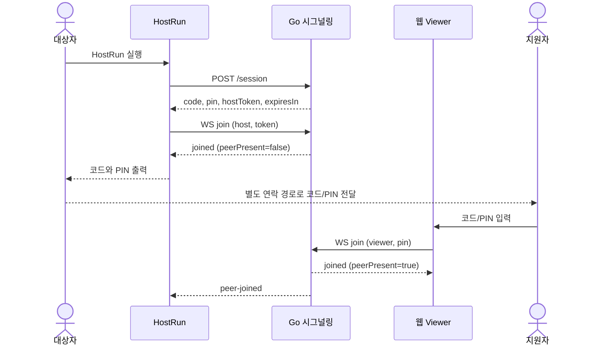
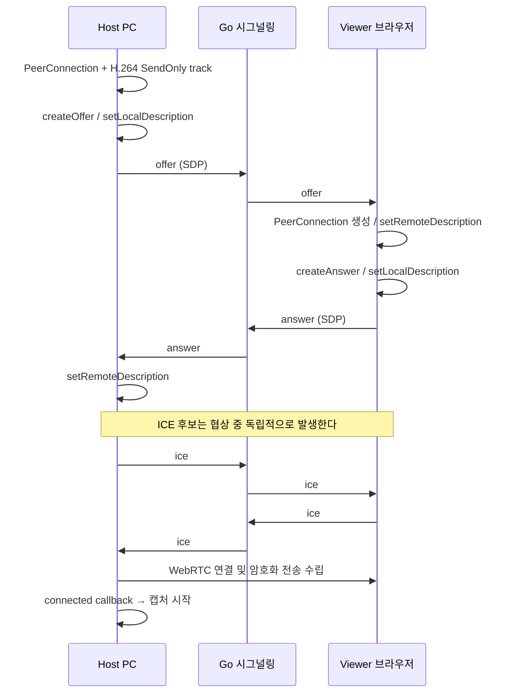
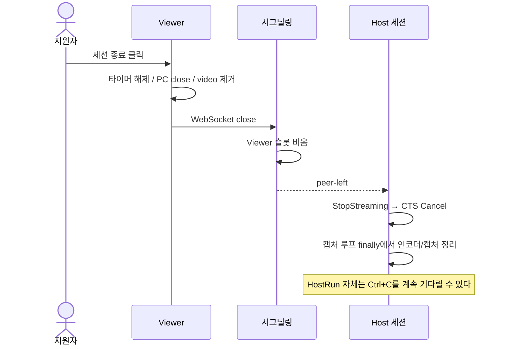
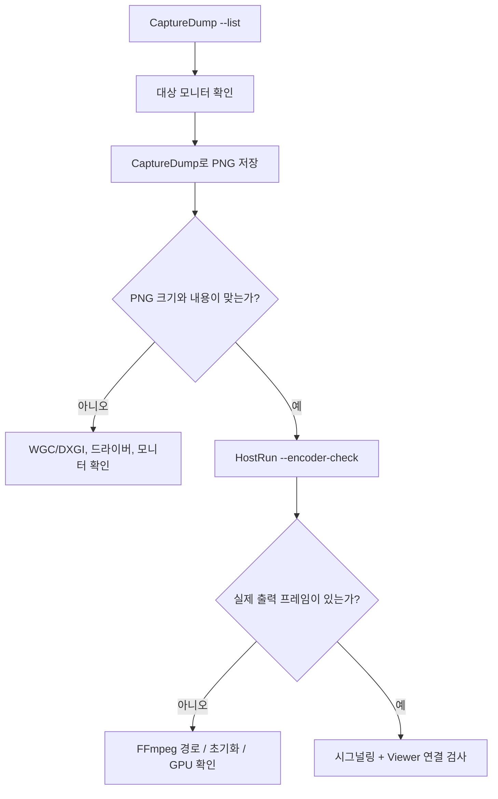
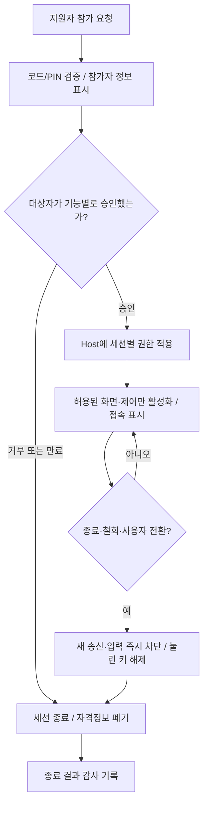
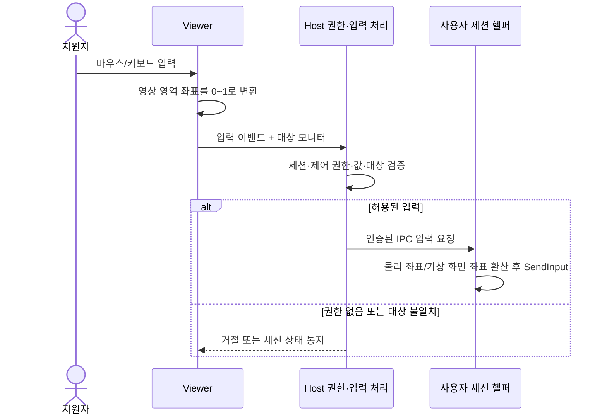
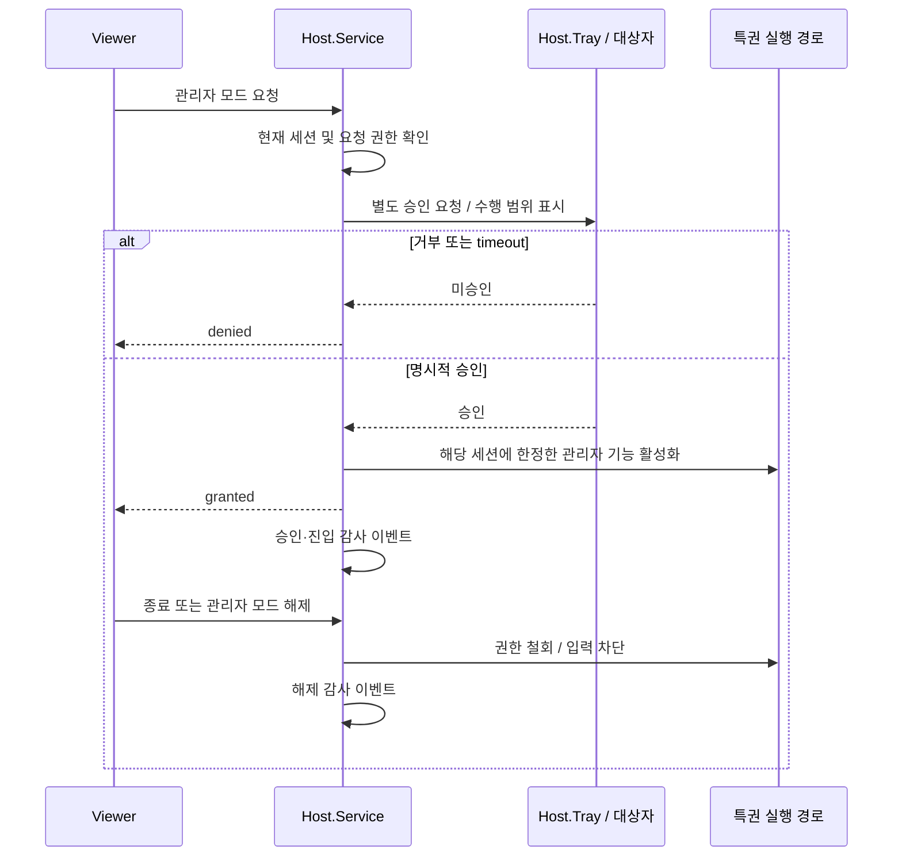
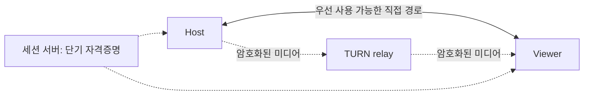
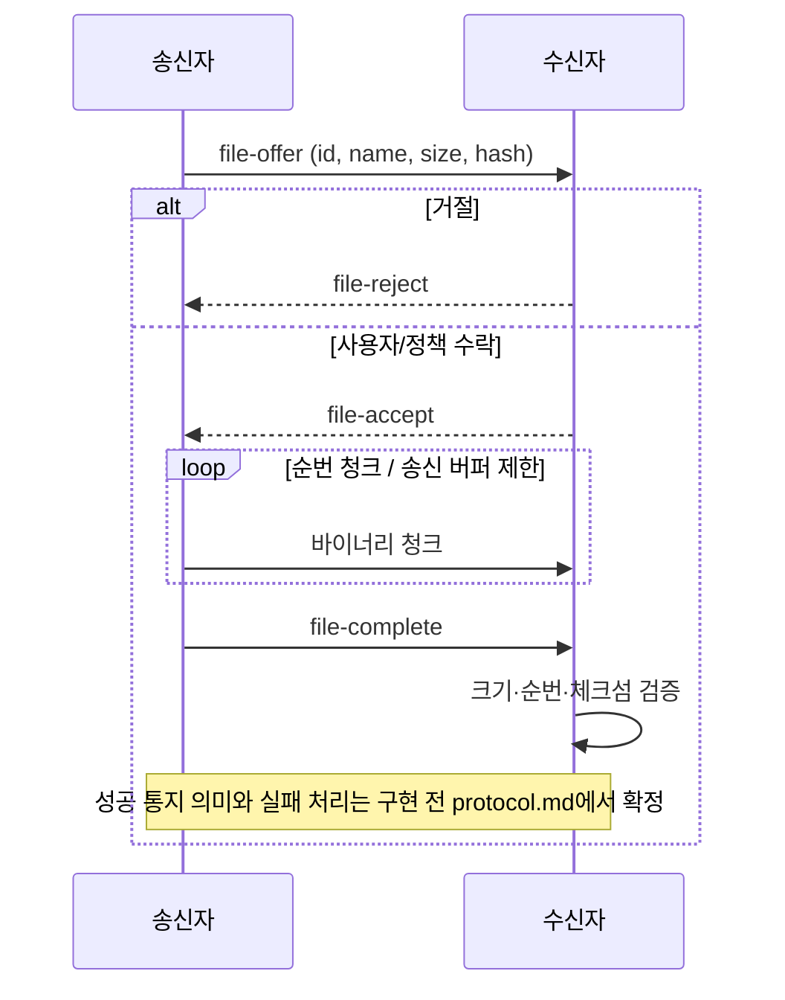
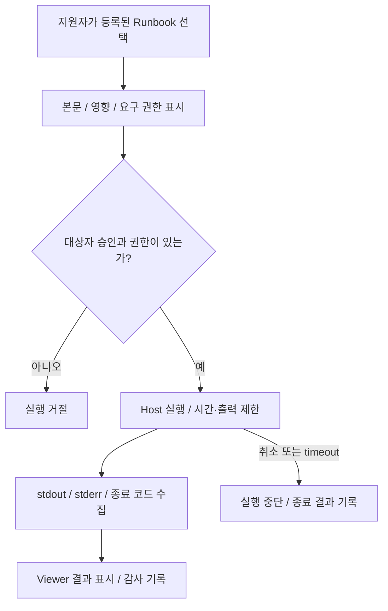

# 기능별 워크플로우

[문서 안내](README.md) · [주요 로직](core-logic.md) · [프로토콜](protocol.md)

각 절은 구현 상태, 시작 조건, 처리, 결과를 설명한다. **1~5절은 현재 구현**, **6~11절은 목표 설계**다. 정상 경로의 다이어그램은 오류·경쟁이 해결되었다는 의미가 아니다.

## 1. 세션 생성과 참가 — 현재 구현

시작 조건은 시그널링 서버가 실행 중이고 HostRun이 해당 서버 주소를 알고 있는 것이다. 서비스나 Tray에서 세션 시작 버튼을 누르는 기능은 아직 없다.

이 그림은 Host가 먼저 참가하는 일반적인 순서다. Viewer가 먼저 있으면 Host의 joined에 `peerPresent=true`가 들어가며 Host가 곧바로 협상을 시작한다. 동시 참가 시 ACK 순서 경쟁은 R05에 남아 있다.

실패 경로에는 코드 없음, 만료, PIN/token 불일치, 잘못된 역할, 이미 점유된 슬롯이 있다. 서버는 error를 보내고 연결을 닫는다. 현재 UI에서는 구체적인 오류가 close 안내로 덮일 수 있다(R16).

**결과:** 두 피어가 동일 Room의 역할 슬롯을 점유한다. 참가 성공 자체는 대상자의 화면 공유 동의를 뜻하지 않는다.

## 2. WebRTC 협상 — 현재 구현

메시지 흐름의 이해를 위해 offer와 answer 뒤에 ICE 교환을 그렸지만 실제 ICE callback은 더 일찍 발생할 수 있다. 현재는 offer보다 먼저 도착한 후보를 Viewer가 버릴 수 있다(R06).

**결과:** PeerConnection이 connected 상태가 되면 Host가 캡처 스레드를 시작한다. 현재 코드에는 이 사이에 대상자 동의 대기 단계가 없다. TURN 서버 목록도 없으므로 직접 연결이 불가능한 환경의 폴백은 아직 기대할 수 없다.

## 3. 화면 표시와 통계 — 현재 구현

1. Host 캡처 스레드가 선택한 backend와 인코더를 생성한다.
2. 캡처한 BGRA를 H.264로 인코딩하고 `SendVideo`한다.
3. 브라우저 WebRTC가 미디어를 수신해 track을 제공한다.
4. Viewer는 video.srcObject를 설정하고 접속 폼을 숨긴다.
5. 1초 주기로 getStats를 호출해 영상 크기·FPS·kbps·경로를 표시한다.

**정적 화면:** 새 캡처 프레임이 없어도 직전 프레임이 있으면 다시 인코딩한다. dirty rect를 이용한 전송 생략이나 적응형 품질은 아직 없다.

**해상도 변경:** WGC 내부 풀은 재생성하지만 인코더 크기는 따라가지 못한다(R02). **인코더 실패:** 연결된 UI가 남고 영상만 없을 수 있다(R07). **통계:** 접속 경로와 디코딩 결과를 함께 확인해야 하며, 높은 입력 루프 처리량만으로 성공을 판단하지 않는다.

## 4. 종료·상대 이탈·네트워크 오류 — 현재 구현

Viewer 종료 버튼은 JSON `bye`를 송신하지 않고 연결을 닫는다. Host의 Ctrl+C는 `await using`을 빠져나가 `DisposeAsync`를 호출한다. 서버는 양쪽 슬롯이 비면 룸을 삭제한다.

| 사건 | 현재 행동 | 제품에서 필요한 결과 |
|---|---|---|
| 지원자 종료 | Viewer 자원 정리, 서버 통지로 Host 취소 | 전체 세션 종료 결과 일치 |
| 대상자 Ctrl+C | Host Dispose 시도 | 미디어 우선 차단, 제한 시간 내 정리 |
| 시그널링만 단절 | Host는 수신 루프만 끝낼 수 있음 | 정의된 정책에 따라 미디어 종료/안전한 복구 |
| WebRTC 일시 단절 | CTS 취소, 재개 불가 | 복구 대기 또는 양쪽에 완전 종료 표시 |
| 협상 중 Viewer 재접속 | 이전 이벤트와 전역 객체 혼선 가능 | 이전 시도 무효화, 새 시도 보존 |

세부 결함은 R07~R12에 있다. 이 상태에서 자동 재접속이나 종료 1초 보장을 이미 구현한 것으로 읽으면 안 된다.

## 5. 캡처·인코더 개별 진단 — 현재 구현

전체 연결에 실패했을 때는 네트워크부터 무조건 의심하지 말고 캡처와 인코더를 분리한다.

`--encoder-check`는 현재 후보마다 실제 프레임을 인코딩하지 않으며 자동 선택 후보 하나만 출력 시험한다. “사용 가능”이나 종료 코드 0만으로 모든 인코더를 통과 처리하지 않는다(R17). 실행 명령은 [개발 가이드](development-guide.md)에 있다.

## 6. 동의·권한·즉시 종료 — 목표 설계

**미구현:** T3.1~T3.5. 핵심 조건은 네트워크 연결 여부와 별개로 Host가 기능 실행 권한을 검증하는 것이다. Viewer UI를 비활성화하는 것만으로 권한을 강제할 수 없다.

승인 항목은 화면 보기, 원격 제어, 관리자 권한으로 분리한다. 파일·클립보드·진단 데이터 같은 보조 기능의 권한 범위는 구현 시 별도 확정한다. 시간 초과나 UI 소실을 암묵적 승인으로 취급하지 않는다.

실행 권한은 세션과 참가자에 묶고, 재접속·세션 이관에 재사용하지 않는다. 종료 이벤트가 늦게 도착한 승인 이벤트보다 우선해야 한다. 현재 프로토콜의 consent 예시는 완성된 권한 상태 머신을 의미하지 않는다.

## 7. 원격 입력과 모니터 전환 — 목표 설계

**미구현:** T2.1~T2.4/T5.5. `InputMsg` 타입만 존재한다.

구현 전에는 unreliable 채널에서 key-up/button-up이 유실될 때의 복구를 정의해야 한다. move의 최신성 요구와 키 전이의 신뢰성 요구가 다르다. 키/버튼 상태 정리, 브라우저 blur, 포커스 상실, 세션 종료를 함께 다룬다.

모니터 전환은 `선택 요청 → 권한/식별자 확인 → 기존 프레임 중단 → 캡처와 인코더 포맷 교체 → 키프레임 → 새 화면/좌표 기준 통지` 순서를 목표로 한다. 전환 중 입력은 이전 모니터로 새어나가지 않아야 한다. 현재 CLI의 초기 모니터 선택은 이 기능의 구현이 아니다.

## 8. 관리자 모드·UAC·SAS — 목표 설계

**미구현:** T5.1/T5.2. 관리자 권한을 승인했다고 일반 프로세스가 곧바로 보안 데스크톱을 조작할 수 있는 것은 아니다. 실행 위치와 권한을 모두 설계해야 한다.

SAS는 일반 키 이벤트를 주입하는 방식이 아니라 별도 control 요청으로 처리할 계획이다. 보안 데스크톱 전환·SendSAS·콘솔/RDP 차이는 최소 검증 프로그램으로 확인한 뒤 통합한다. 승인 메시지의 상세 IPC 계약과 헬퍼 프로세스 구성은 아직 미확정이다.

## 9. TURN과 연결 복구 — 목표 설계

**미구현:** T4.1~T4.3 중 TURN/복구. STUN 주소 설정만 일부 존재한다.

목표 흐름은 세션에 허용된 단기 TURN 자격증명을 양쪽에 전달하고, ICE가 직접 후보와 relay 후보를 검사해 연결 가능한 경로를 선택하도록 하는 것이다. “P2P 실패를 기다린 후 수동으로 다른 전송 프로토콜을 켠다”는 뜻이 아니다. 실제 후보 수집·선택 정책은 통합 시 확정한다.

경로 표시는 선택된 candidate pair 양끝을 확인한다. 재연결 정책에는 시도 시간, ICE generation, 이전 후보 폐기, 동의 유지 조건, 실패 시 종료를 포함한다. P2P 차단 상태에서 relay 강제 연결을 별도로 검증해야 한다.

## 10. 파일·채팅·클립보드 — 목표 설계

**미구현:** T5.3/T5.4. 아래는 기존 프로토콜의 개념 흐름이며 청크 헤더·재전송·동시 전송 제한은 아직 완성된 와이어 명세가 아니다.

파일명으로 임의 경로에 쓰지 않도록 저장 위치·덮어쓰기·경로 이탈·디스크 부족·중단 정리를 정의해야 한다. 네트워크 전송 완료와 체크섬 검증 완료는 다른 상태다. 파일 전송은 감사 대상이다.

채팅은 텍스트 메시지를 주고받는 기능이다. 클립보드는 자동 읽기/쓰기라는 별도 영향이 있으므로 채팅 허용만으로 항상 켜지지 않도록 범위·동의·크기 제한을 확정한다. 파일·클립보드의 실패가 화면 종료를 요구하는지 여부도 명시적으로 정한다.

## 11. 상태 대시보드·Runbook·AI — 목표 설계

**미구현:** T5.6/T5.7. 우선 차별화 기능은 상태 대시보드와 Runbook이다.

대시보드는 허용된 CPU·메모리·디스크·네트워크·이벤트 정보 등을 Host가 수집하고 Viewer가 표시하는 흐름이다. 수집 주기·권한·민감정보 제거·채널 배치를 protocol에 확정해야 한다. 화면 보기 권한만으로 모든 진단 데이터 수집을 허용한다고 가정하지 않는다.

Runbook은 등록된 스크립트의 선택·미리보기·승인·실행·결과 기록을 하나의 작업으로 다룬다. 명령 실행 권한과 관리자 권한을 구분하고, UI가 닫혀도 실행이 무제한 남지 않도록 취소 정책을 설계한다.

AI 어시스턴트는 이후 로그 요약과 조치 제안을 돕는 백로그다. 실행형 조치는 동일한 승인·권한·감사 경로를 지나야 한다. 무인 상시 접속, 세션 이관·관전, 녹화, RBAC, 원격 탐색기는 별도 후속 설계 대상이며 현재 제품 기능으로 안내하지 않는다.
